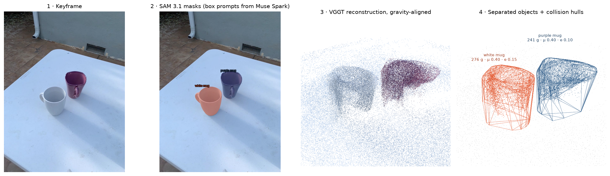
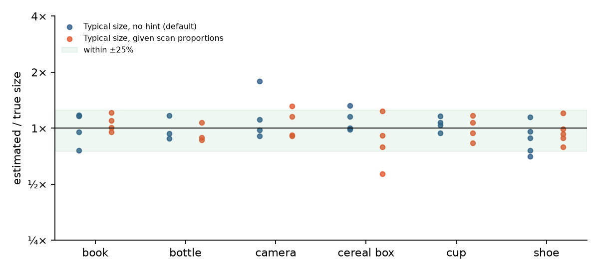
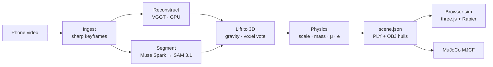

<h1 align="center">Scan2Sim</h1>

<p align="center">
  <b>Phone video in, physics-ready digital twin out.</b><br>
  Every object on the table reconstructed, separated, named, metrically scaled, and given mass, friction and bounciness,<br>
  then simulated live in the browser or exported to MuJoCo.
</p>

<p align="center">
  <a href="https://github.com/DanielTong50/3d-visualization/actions/workflows/ci.yml"></a>
  <a href="https://danieltong50.github.io/3d-visualization/"></a>
  
  
</p>

<p align="center"></p>

## Results

Evaluated end to end on **24 Objectron phone videos** (6 tabletop classes × 4 test-split clips), against
ARKit-measured metric 3D boxes, with no per-clip tuning. Full method, ablation and per-object table:
**[docs/results.md](docs/results.md)**.

| | |
|---|---|
| Objects detected and separated into 3D rigid bodies | **24 / 25** |
| Labels correct | **100%** |
| Metric size within ±25% of ground truth | **88%** |
| Median estimated / true size | **0.99×** |
| Median processing time, video to scene | **197 s** |

<p align="center"></p>

The reconstruction has no scale of its own. Every object's metric size comes from Muse Spark
recognizing it and voting on the scene scale, so this measures detection, tracking, 3D separation,
recognition and scale estimation together. The physics engine is checked against closed-form mechanics
in CI: a pushed box slides the closed-form `v0²/(2μg)` (asserted within 8%), and every shipped scene settles at rest in both
Rapier and MuJoCo.


## Why

Simulation is how robots and embodied agents are trained and tested, but a *physically accurate*
copy of a real place still takes days of manual modeling: each object's shape, mass and friction,
tuned by hand. Reconstructing geometry from video is largely solved. **Per-object physics is the
bottleneck for real-to-sim.** Scan2Sim closes that gap automatically, from a 20–60 second phone clip.

## How it works



| Stage | What happens | Key idea |
|---|---|---|
| **Ingest** | 48 time bins, the sharpest frame (Laplacian variance) wins each bin; blurry bins are dropped | The keyframe clip SAM tracks *is* the frame set VGGT reconstructs, so 2D→3D is a lookup |
| **Reconstruct** | [VGGT](https://github.com/facebookresearch/vggt) predicts all cameras and depth in one feed-forward pass (~2 s on an L40S) | No SfM, no crop: portrait video keeps its full field of view |
| **Segment** | Muse Spark names every object and boxes it on a keyframe; SAM 3.1 tracks those *boxes* through the clip | Box prompts make tracking independent of wording, which SAM's text prompts are not |
| **Lift** | RANSAC table plane near the objects, oriented toward the cameras, defines gravity; per-voxel majority vote across all views assigns labels | Mask bleed in one view is outvoted by the others |
| **Physics** | Muse Spark supplies material, hollowness, typical size, friction, restitution; geometry supplies the rest | **Scale** is a confidence-weighted median of per-object size votes; **mass** = hull volume × density × fill fraction |
| **Package** | Object-local PLY points and convex-hull OBJ colliders, one validated `scene.json` | One versioned contract between pipeline and any simulator |

The full write-up with every design decision is in **[docs/architecture.md](docs/architecture.md)**.

## Demos

**[Open the live demo →](https://danieltong50.github.io/3d-visualization/)** Pre-processed scenes load
instantly: grab and throw objects, tap one for its physics card, change its material, switch gravity, or
type a "what if".

| Scene | Source | What to try |
|---|---|---|
| Two mugs | Real scan: Objectron `cup/batch-3/4`, 7 s of video, 26 keyframes | Tap a mug: ceramic, ~260 g, estimated from its scanned volume; flick one into the other |
| Physics sandbox | Hand-authored | Heavy book vs. light tissue box; the rubber ball vs. the ceramic mug |

Export any scene for robotics work: `uv run python -m scan2sim.export scenes/<id>` writes MJCF that
loads and settles in MuJoCo (checked in CI).

## Quick start

```bash
git clone https://github.com/DanielTong50/3d-visualization.git && cd 3d-visualization

# Simulator only (no keys needed): opens the bundled scenes
cd frontend && npm ci && npm run dev

# Pipeline: needs a Meta Model API key, a Hugging Face token (VGGT-1B-Commercial), and Modal
cp .env.example .env                                  # fill in the keys
cd pipeline && uv sync
uv run modal secret create scan2sim --from-dotenv ../.env
uv run modal run modal_app.py --video ~/Movies/desk.mov --name desk   # writes scenes/desk
```

`uv run pytest` and `npm test` run offline. See [CONTRIBUTING.md](CONTRIBUTING.md) for the full
workflow, including the evaluation.

## Repository

```
pipeline/scan2sim/   frames · reconstruct · segment · lift · physics · package · export · reality_check · whatif · api
pipeline/modal_app.py   Modal GPU/CPU functions, warm VGGT class, web API
frontend/            React + three.js + Rapier simulator
scenes/              scene packages (sandbox = hand-authored reference; objectron-mugs = real scan)
docs/                architecture · scene format + JSON schema · results · design · verified API notes
```

## Models

| Model | Role | Notes |
|---|---|---|
| [VGGT-1B-Commercial](https://huggingface.co/facebook/VGGT-1B-Commercial) (Meta) | Cameras, depth, confidence | Self-hosted on Modal; commercial-use weights |
| Muse Spark 1.3 (Meta Model API) | Object detection with boxes; material, size and physics priors; "what if" tool calling | JSON-schema constrained output, validated with Pydantic |
| SAM 3.1 (Meta Model API) | Box-prompted video object tracking; push tracking for the reality check | Streamed, parsed with `meta-sam-parser` |

## Limitations

- **Reality check is validated on synthetic data only.** The friction estimator recovers μ within 12%
  on noisy synthetic tracks and the pixel→meter conversion assumes a near-top-down camera, but no real
  push videos have been processed yet.
- **Scale depends on recognizable objects.** A scene of unfamiliar objects falls back to low-confidence
  votes (flagged in `scale_source`). The largest size errors in the evaluation are thin objects whose
  depth is overestimated (a compact camera at 1.8×) and tightly packed store shelves, where neighboring
  boxes merge into one object.
- **Undersides are never observed.** Colliders assume an object rests on the footprint of its lower half;
  strongly concave objects are approximated by one convex hull.
- **Point-cloud rendering**, not photorealistic; moved objects leave a hole in the background scan.
- Glass, mirrors and polished metal break reconstruction.

## Acknowledgements

VGGT by Wang et al. (CVPR 2025), [VGGT License](https://github.com/facebookresearch/vggt/blob/main/LICENSE.txt).
Objectron by Ahmadyan et al. (CVPR 2021), used under the
[C-UDA 1.0](https://github.com/google-research-datasets/Objectron/blob/master/LICENSE) for evaluation and the
demo scan. Muse Spark, SAM 3.1 and the Meta Model API by Meta. Rapier by Dimforge; three.js; Modal.

## License

[MIT](LICENSE) for the code in this repository. Model weights and datasets keep their own licenses (above).
