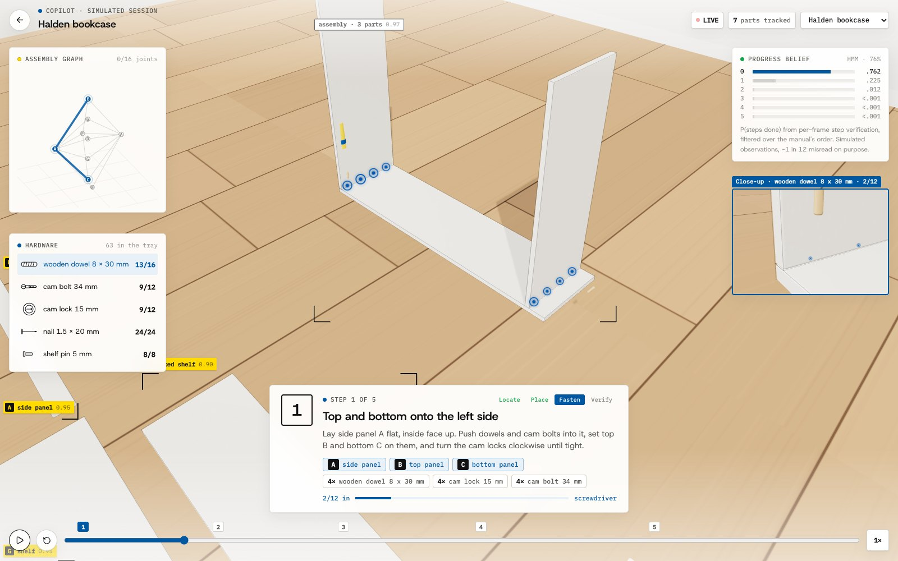
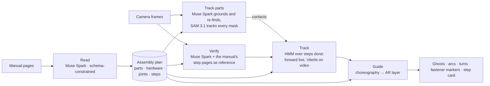
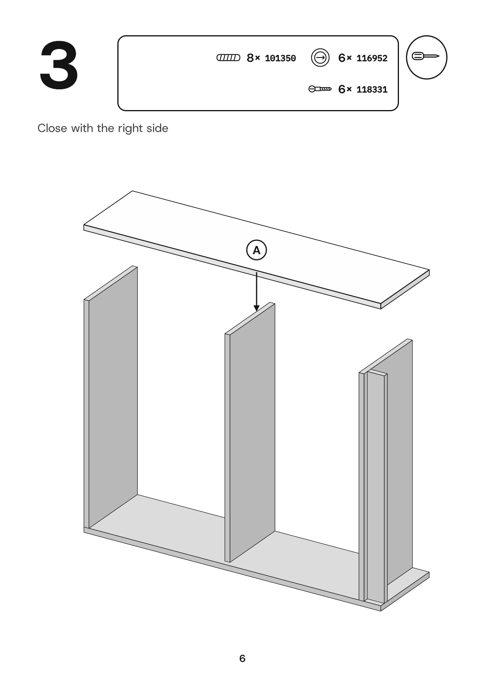
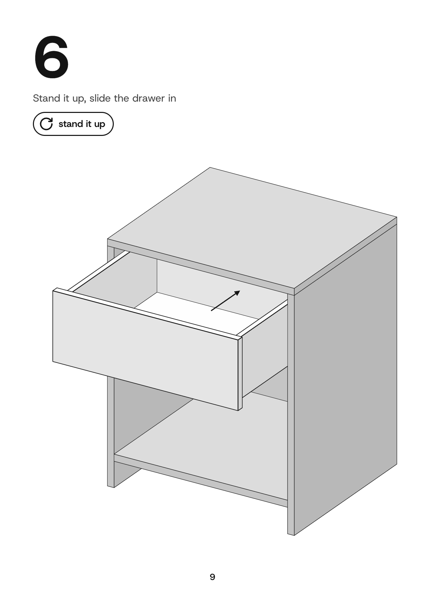
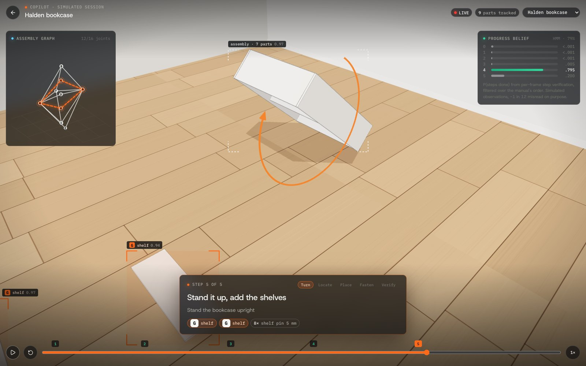
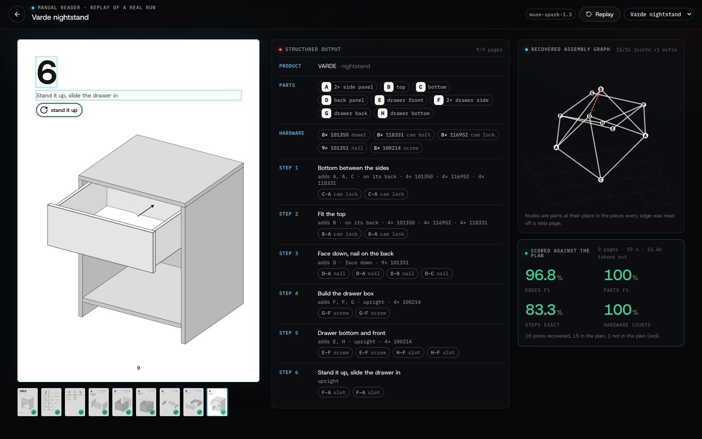
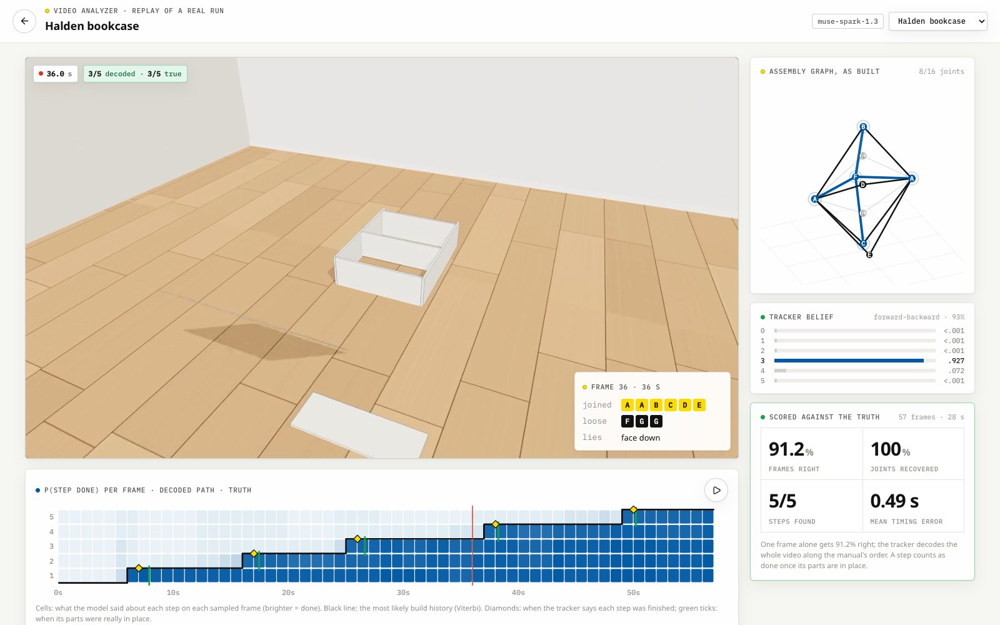
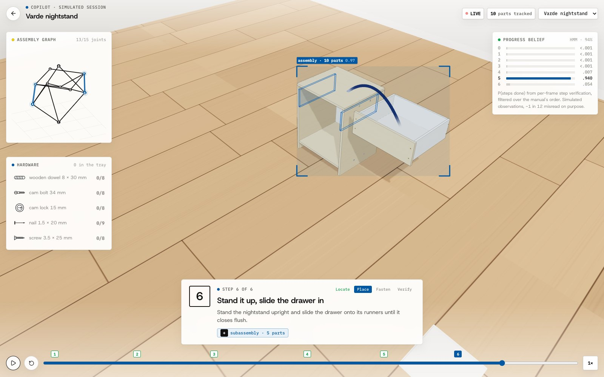

<h1 align="center">Darius</h1>

<p align="center">
  Flat-pack manuals parsed into assembly graphs · every part tracked through build video with SAM 3.1 · progress decoded against the graph with an HMM · AR guidance, down to every dowel and screw, rendered from the plan's geometry
</p>

<p align="center">
  <a href="https://github.com/DanielTong50/3d-visualization/actions/workflows/ci.yml"></a>
  <a href="https://danieltong50.github.io/3d-visualization/"></a>
  
  
  
  
  
  
</p>

<p align="center"></p>
<p align="center"><sub>Step 1 of a bookcase, mid-fastening: each fitting flies from the tray to its hole and goes in (close-up, right), the hardware panel counts what is left, the assembly graph fills in, and the tracker's belief over "steps done" comes from per-frame step verification.</sub></p>

**Abstract.** Darius treats a furniture manual as a graph *G = (P, J, S)*: parts *P* are nodes, joints *J* are edges
that carry their hardware and the pose of every fastener, and steps *S* order the edges and fix how the piece lies.
A vision-language model (Muse Spark 1.3) reads all pages of a manual in one request under a JSON-schema constraint, and
a deterministic resolver turns the reading into a validated plan: repeated letters become part instances, parts drawn
without an arrow are brought in, every connection resolves to a pair of instances. Build progress is the hidden state
*k ∈ {0..|S|}* of a hidden Markov model whose emissions are per-frame step verifications, made with the manual's own
step drawings as visual references; Viterbi gives the build history and forward–backward its confidence. Every part
is also tracked through the video: Muse Spark grounds each piece on the first frame and finds lost ones again from
numbered outlines (set-of-mark prompting), SAM 3.1 propagates every piece's mask, and masks that hold contact become
plan-conditioned evidence of which joints are made. Guidance is computed from the plan alone: every part's pose, every
fitting's seat and every tool stroke, at every instant. On a four-product library with generated manuals and rendered
sessions with exact part masks, the manual reader recovers **99.2%** of joints (edge F1) and **100%** of parts and
hardware counts, the tracker finds **18/18** build steps with a **1.16 s** mean timing error, and SAM 3.1's part
tracks reach **67.1%** mask IoU against the exact masks. Every number is a stored model run that CI re-scores on each
commit.

## At a glance

Every number below is a stored run of `darius eval` on the furniture library (Muse Spark 1.3 and SAM 3.1,
2026-10-28), replayed by the [demos](https://danieltong50.github.io/3d-visualization/) and re-scored on every commit by
CI.

| | Halden bookcase | Varde nightstand | Lund side table | Ostra desk |
|---|---:|---:|---:|---:|
| Size: parts · joints · steps | 9 · 16 · 5 | 10 · 15 · 6 | 9 · 12 · 4 | 5 · 7 · 3 |
| **Manual → graph**: parts F1 | 100% | 100% | 100% | 100% |
| Edges (joints) F1 | **100%** | **96.8%** | **100%** | **100%** |
| Steps read exactly | 100% | 83.3% | 100% | 100% |
| Hardware counts | 100% | 100% | 100% | 100% |
| **Video → timeline**: build steps found | **5 / 5** | **6 / 6** | **4 / 4** | **3 / 3** |
| Frames with the right progress | 88.7% | 81.2% | 93.9% | 94.7% |
| Mean error dating each step | 1.21 s | 2.30 s | 0.63 s | 0.52 s |
| **Video → part tracks** (SAM 3.1): mask IoU, exact masks | 56.6% | 57.1% | 68.2% | **86.4%** |
| Part-frames held (IoU ≥ 0.5) | 56.2% | 61.4% | 75.2% | 92.1% |
| Letters right, up to look-alikes | 5 / 9 | 4 / 10 | 5 / 9 | 5 / 5 |
| Frames right from mask contacts alone | 27.4% | 63.8% | 61.2% | 92.1% |
| … from the exact masks' contacts | 91.9% | 91.3% | 95.9% | 92.1% |

The one joint the manual reader got wrong in four manuals: it also nailed the nightstand's back panel to the top.
The model reads all of a manual in 35–70 s; a 60 s video takes about 30 s to decode (15 requests, 6 at a time).
Tracking a session's parts takes 3–7 minutes: Muse Spark's looks, two SAM 3.1 passes, and the re-found prompts in
between (51 across the four videos). Contacts from perfect tracks would get 92.8% of frames right, more than Muse
Spark's frame readings (89.6%); SAM's tracks get 61.1%, so tracking quality is where the headroom is.

## How it works



A manual is a graph in disguise. **Parts** (the lettered panels, legs and shelves) are nodes; **joints** (two parts
held by dowels, cam locks, screws, nails or a groove) are edges; **steps** put the edges in order and say how the
piece lies while you work. Darius recovers that graph, tracks your progress through it, and turns its geometry into
guidance.

| Stage | What happens | The idea that makes it work |
|---|---|---|
| **Read** (`perception/manual.py`) | All pages go to Muse Spark in one request with a JSON schema: parts by letter with counts, hardware by article number, and for every step the parts brought in, the hardware box, the build orientation drawn and every pair of parts joined | The model only reads; `to_plan` builds the graph. Repeated letters become instances (`A1`, `A2`), each connection resolves to the piece brought in now, then one not yet paired, then the least joined, and the part a step builds on comes in even when it is drawn without an arrow. `validate` reports anything that does not add up |
| **Verify** (`perception/frames.py`) | A few consecutive frames per request, with the plan's parts, what the build looks like after every step, **and the manual's step pages as reference images**; the model says which steps are done, how sure it is, which letters are joined and loose, and how the piece lies | Comparing the frame with the manual's own drawings: on the bookcase, scored the same way, it lifted the frames with the right progress from 81% to 91% and cut the mean timing error from 2.4 s to 0.5 s (the face-down back panel was missed without them) |
| **Track parts** (`perception/parts.py`) | Muse Spark grounds every piece on the first frame (letter, box, a point on it) and **SAM 3.1** tracks all of them through the video in one request, forward and backward; every 4 s Muse Spark looks again for the parts SAM lost, given the first frame with every part outlined and numbered, and SAM picks them up from there. Masks that touch for a second become contacts | Box *and* point prompts, so SAM takes the thin leg and not the floor plank around it; a close second look at a crop for thin parts, and letters by majority over three looks; the second SAM pass only fills frames the first lost. Contacts are counted by pair of letters against the joints each step adds, in the manual's order (twins share a letter), and fused with the readings as a product of experts |
| **Track** (`assembly/tracking.py`, mirrored in `engine/tracking.ts`) | A hidden Markov model over *k*, the number of steps done. Live, the forward algorithm updates the belief after every frame; for a whole video, Viterbi gives the most likely build history and forward-backward its confidence | A build follows the manual: transitions stay (.86), advance (.11), rarely skip (.02) or undo (.01). Each frame's P(step done) is capped to [.15, .85] and tempered by .7, so one misread frame cannot move the build |
| **Guide** (`engine/choreography.ts`, `three/Stage.ts`) | Every instant of the build is computed from the plan: turn the piece to the step's orientation, locate the parts, carry them on arcs to their poses, then fasten: each dowel, cam bolt, cam lock, screw, bolt, nail and shelf pin flies from the tray to its hole and goes in, driven by the step's tool, with a close-up of the piece going in | Seats come from each joint's hole pattern: dowels straddle the joint, screws and nails sit flush with the face they enter, cam locks sit in the face of the panel the bolt reaches into; seated fittings ride with their part through every turn. Subassemblies built on the side join as one piece; detection boxes are the parts' projected geometry |

### The assembly plan

One Pydantic schema (`engine/darius/assembly/schema.py`, exported as [`docs/plan.schema.json`](docs/plan.schema.json),
mirrored in [`frontend/src/engine/plan.ts`](frontend/src/engine/plan.ts)) is produced three ways and compared on
equal terms: procedurally with exact geometry (the ground truth), by reading a manual, and as a timeline by watching a
video.

```jsonc
// assemblies/halden-bookcase/plan.json (abridged)
{
  "parts":    [{ "id": "A1", "label": "A", "name": "side panel", "size_mm": [18, 1060, 280], "assembled": {…}, "layout": {…} }, …],
  "hardware": [{ "id": "116952", "name": "cam lock 15 mm", "kind": "cam_lock", "count": 12 }, …],
  "joints":   [{ "id": "J1", "parts": ["B", "A1"], "kind": "cam_lock",
                 "hardware": [{ "id": "101350", "count": 2 }, …],
                 "fasteners": [{ "hardware": "118331", "position": [-382, 1051, -35], "axis": [-1, 0, 0] }, …] }, …],
  "steps":    [{ "index": 1, "title": "Top and bottom onto the left side", "parts": ["A1", "B", "C"],
                 "joints": ["J1", "J2"], "orientation": "on_side", "tools": ["screwdriver"], … }, …]
}
```

The algorithms, with their numbers, are in [docs/architecture.md](docs/architecture.md). Graph scores
(`assembly/graph.py::compare`) count parts and joints **by letter**: which of two identical side panels
is `A1` is arbitrary, so edges are compared as multisets of letter pairs.

## The furniture library: ground truth from geometry

`engine/darius/furniture` is a small **flat-pack compiler**. A product is declared as boxes with millimeter sizes and
positions; `FurnitureBuilder` finds every contact from the geometry, lays out hardware per joint kind (a cam-lock
joint is dowel, cam bolt, cam bolt, dowel; nails every ~15 cm), assigns each part a spot on the floor, and checks the
plan. The library has four products: a bookcase built on its side and nailed face down, a nightstand whose drawer is
built separately and slid in, a side table made of two frames and turned upside down for its top, and a desk.

From each plan, the web app **generates its manual**: hidden-line drawings in the flat-pack style
([`three/ManualArt.ts`](frontend/src/three/ManualArt.ts)), a parts page, a hardware page and a page per step with
letter callouts, arrows and the hardware box. Parts come off along a *free* way in: away from the part they join,
unless parts already in place block the sweep (shelves between two sides slide in from the front, the drawer comes in
from the front as one piece). And it **films each build** as a handheld session with frame-exact ground truth.
Those pages and videos are what the models are tested on (`frontend/scripts/capture.mjs`).

<p align="center"> &nbsp; </p>

## Demos

| | |
|---|---|
| [**Copilot session**](https://danieltong50.github.io/3d-visualization/?view=ar) · a whole build guided, with tracked parts, ghosts and arcs, turns, fastener markers, the graph and the tracker's belief (simulated perception, one frame in twelve misread on purpose) |  |
| [**Manual reader**](https://danieltong50.github.io/3d-visualization/?view=manual&furniture=varde-nightstand) · a real run replayed: each page is scanned while the model's structured output fills in and the graph grows edge by edge, then it is scored against the plan |  |
| [**Video analyzer**](https://danieltong50.github.io/3d-visualization/?view=video) · a filmed build with SAM 3.1's mask on every part, Muse Spark's reading of every sampled frame, the evidence heatmap, the decoded build history against the truth, and the graph the masks' contacts show |  |
| [**Live**](https://danieltong50.github.io/3d-visualization/?view=live) · your camera: pick a library product or photograph a manual (read into a plan by the API), then build; a frame is checked every few seconds and the tracker runs in the browser. A video file or a filmed build can stand in for the camera |  |

## Repository

```
engine/                     Python 3.11 (uv): the copilot's brain
  darius/assembly/          schema, graph ops (validate, subassemblies, compare), HMM tracker, guidance
  darius/furniture/         the flat-pack compiler and the four-product catalog
  darius/models/            Meta Model API clients: Muse Spark (schema-constrained JSON) and SAM 3.1 (streamed masks)
  darius/perception/        manual pages -> plan · frames -> evidence · video -> timeline · video -> part tracks
  darius/eval/              darius eval: run, store and score the models on the library
  darius/service/           FastAPI: /library, /manuals, /frames, /videos
  modal_app.py              the API on Modal (CPU, scale to zero)
frontend/                   React 19 + three.js, TypeScript
  src/engine/               plan types, graph ops, the tracker (TS mirror), choreography, results
  src/three/                the workshop stage and AR layer · manual line art
  src/pages/                Home · copilot session · manual reader · video analyzer · live
  scripts/capture.mjs       renders manual pages, session videos, exact part masks and posters with Playwright
assemblies/                 the library: plan.json, manual pages, session.mp4 + truth.json + ids.bin.gz (exact masks),
                            stored model outputs (reading.json, analysis.json, tracks.json), benchmarks.json
docs/                       architecture.md · plan.schema.json · API notes
```

## Run it

```bash
# Engine
cd engine && uv sync
uv run darius library                      # the products
uv run darius show halden-bookcase         # a plan and its graph, step by step
uv run pytest -q                           # 38 tests, no API calls
uv run darius eval --check                 # stored model results re-score to the published numbers

# With a Meta Model API key in ../.env (see .env.example)
uv run darius manual ../assemblies/ostra-desk/manual --truth ostra-desk   # read a manual, score it
uv run darius track video.mp4 --plan halden-bookcase                      # decode a build video
uv run darius parts video.mp4 --plan halden-bookcase                      # track every part (Muse Spark + SAM 3.1)
uv run darius eval                                                        # re-run the whole benchmark

# Web app
cd frontend && npm ci && npm run dev       # http://localhost:5173
npm test                                   # 47 tests
node scripts/capture.mjs                   # regenerate manual pages and session videos

# API (live mode)
cd engine && uv run uvicorn darius.service.api:local_app --factory --port 8787
cd frontend && VITE_API_URL=http://127.0.0.1:8787 npm run dev
cd engine && uv run modal deploy modal_app.py
```

## Limits, honestly

- **The test data is generated.** Manuals are drawn from plans and sessions are rendered: real manuals are wordless
  and denser, and real videos have hands, clutter, motion blur and hardware the size of a fingernail. The pipeline is
  built for real input (live mode takes photographed pages and a phone camera), but the published numbers are on the
  library.
- **"Done" means the parts are in place.** Nothing visible happens in a rendered session while a step is fastened,
  so a step counts as done in video once its parts sit where they belong; the copilot's verify phase is where the
  fastening is checked with the person.
- **On these sessions the tracker does not raise frame accuracy**: the model's readings were already consistent from
  frame to frame. What it adds is a monotone build history with a confidence for every moment, and robustness when a
  frame is misread, which the tests and the copilot demo exercise with injected misreads.
- **SAM 3.1 loses parts the way trackers do.** It drops a part that leaves the frame (the session camera comes in
  close to fasten) and, without the second look, did not find it again; once panels that look alike are joined, it
  can swap them. Masks touch in the image without the parts touching in space, so contacts carry false edges.
- **Contacts do not yet move the decoded timeline.** Fused with Muse Spark's readings (at half weight) they leave its
  timeline as it was on all four sessions. Contacts of the renderer's exact masks, alone, would beat the readings on
  three of the four, so the headroom is in the tracks; the fusion weight is conservative and is not tuned on four
  sessions. Grounding letters and tracks vary from run to run; the numbers are one run per product.
- **Part tracking is a batch job**: minutes per video (a SAM 3.1 pass takes 60–110 s, Muse Spark's looks run in
  parallel), so it runs in `darius eval` and the CLI, not in live mode.
- **Live mode answers in about 5 s per check** (one Muse Spark call with the step pages as reference), fine for
  furniture, where a step takes minutes, and too slow for anything faster.

## References

The methods Darius implements or builds on, and where each one shows up. Darius is independent work, not affiliated with
these authors.

| Paper | In Darius |
|---|---|
| L. R. Rabiner. *A Tutorial on Hidden Markov Models and Selected Applications in Speech Recognition.* Proc. IEEE, 1989 | The progress tracker: an HMM over "steps done", forward filtering live, recursions in log space |
| A. J. Viterbi. *Error Bounds for Convolutional Codes and an Asymptotically Optimum Decoding Algorithm.* IEEE Trans. Inf. Theory, 1967 | The most likely build history of a video |
| L. E. Baum, T. Petrie, G. Soules, N. Weiss. *A Maximization Technique Occurring in the Statistical Analysis of Probabilistic Functions of Markov Chains.* Ann. Math. Stat., 1970 | Forward–backward posteriors: the confidence of every decoded moment |
| A. Richard, H. Kuehne, A. Iqbal, J. Gall. *NeuralNetwork-Viterbi: A Framework for Weakly Supervised Video Learning.* CVPR 2018 | Decoding a procedure video under an ordered transcript: the manual's steps constrain the path |
| R. Wang, Y. Zhang, J. Mao, C.-Y. Cheng, J. Wu. *Translating a Visual LEGO Manual to a Machine-Executable Plan.* ECCV 2022 | Manual pages to an executable assembly plan, the manual reader's problem |
| R. Wang, Y. Zhang, J. Mao, R. Zhang, C.-Y. Cheng, J. Wu. *IKEA-Manual: Seeing Shape Assembly Step by Step.* NeurIPS 2022 Datasets and Benchmarks | Manuals aligned with parts and assembly graphs, the representation Darius builds on |
| Y. Ben-Shabat, X. Yu, F. Saleh, D. Campbell, C. Rodriguez-Opazo, H. Li, S. Gould. *The IKEA ASM Dataset: Understanding People Assembling Furniture through Actions, Objects and Pose.* WACV 2021 | Furniture assembly as video understanding, the video analyzer's setting |
| F. Sener, D. Chatterjee, D. Shelepov, K. He, D. Singhania, R. Wang, A. Yao. *Assembly101: A Large-Scale Multi-View Video Dataset for Understanding Procedural Activities.* CVPR 2022 | Step recognition and progress in procedural assembly video, the tracker's task |
| X. Wang, T. Kwon, M. Rad, B. Pan, I. Chakraborty, et al. *HoloAssist: an Egocentric Human Interaction Dataset for Interactive AI Assistants in the Real World.* ICCV 2023 | An assistant that watches a task and guides it, the copilot's interaction model |
| A. Kirillov, E. Mintun, N. Ravi, H. Mao, C. Rolland, L. Gustafson, T. Xiao, S. Whitehead, A. C. Berg, W.-Y. Lo, P. Dollár, R. Girshick. *Segment Anything.* ICCV 2023 | Segmentation prompted by boxes and points: every part's prompt |
| N. Ravi, V. Gabeur, Y.-T. Hu, R. Hu, C. Ryali, T. Ma, H. Khedr, R. Rädle, C. Rolland, L. Gustafson, et al. *SAM 2: Segment Anything in Images and Videos.* ICLR 2025 | Propagating prompted masks through a video, forward and backward, with prompts on several frames |
| N. Carion, L. Gustafson, Y.-T. Hu, S. Debnath, R. Hu, D. Suris, C. Ryali, K. V. Alwala, H. Khedr, et al. *SAM 3: Segment Anything with Concepts.* arXiv, 2025 | The model family of SAM 3.1, which tracks every part |
| J. Yang, H. Zhang, F. Li, X. Zou, C. Li, J. Gao. *Set-of-Mark Prompting Unleashes Extraordinary Visual Grounding in GPT-4V.* arXiv, 2023 | Finding lost parts again: the first frame with every part outlined and numbered |
| G. E. Hinton. *Training Products of Experts by Minimizing Contrastive Divergence.* Neural Computation, 2002 | Fusing mask contacts with the frame readings |
| B. T. Willard, R. Louf. *Efficient Guided Generation for Large Language Models.* arXiv, 2023 | JSON-schema-constrained decoding, used for every model reading |
| M. Agrawala, D. Phan, J. Heiser, J. Haymaker, J. Klingner, P. Hanrahan, B. Tversky. *Designing Effective Step-by-Step Assembly Instructions.* SIGGRAPH 2003 | Instructions generated from geometry: the generated manuals |
| W. Li, M. Agrawala, B. Curless, D. Salesin. *Automated Generation of Interactive 3D Exploded View Diagrams.* SIGGRAPH 2008 | Explosion directions from blocking constraints: how a manual drawing pulls each part out |
| R. H. Wilson, J.-C. Latombe. *Geometric Reasoning About Mechanical Assembly.* Artificial Intelligence, 1994 | Removal directions among the parts in place: the sweep test behind the free way in |
| R. E. Tarjan. *Efficiency of a Good But Not Linear Set Union Algorithm.* J. ACM, 1975 | Union-find: the subassemblies after every step |
| Y. Lee, E. S. Hu, J. J. Lim. *IKEA Furniture Assembly Environment for Long-Horizon Complex Manipulation Tasks.* ICRA 2021 | Furniture as parts with connection points, the structure the flat-pack compiler produces |

## History

Darius 0.2 was a real-to-sim scene compiler for robotics (phone video to MuJoCo, OpenUSD and a browser simulator);
it is preserved at the [`v0.2.0`](https://github.com/DanielTong50/3d-visualization/tree/v0.2.0) tag. Darius 1.0 is the
assembly copilot: see the [changelog](CHANGELOG.md).

## License

MIT. See [LICENSE](LICENSE).
