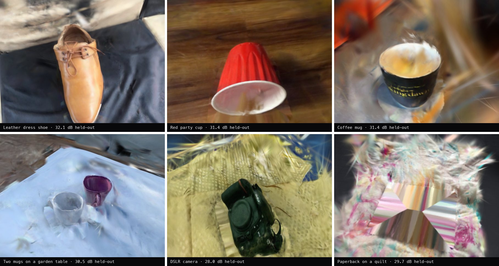
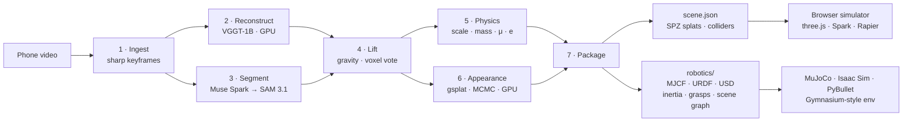
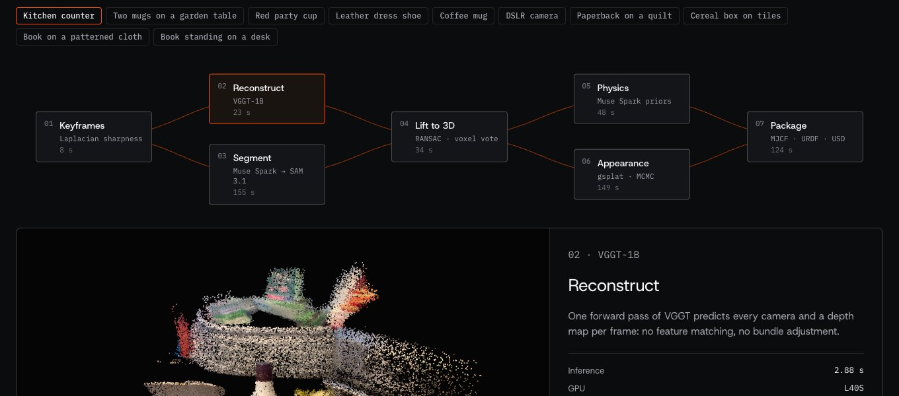
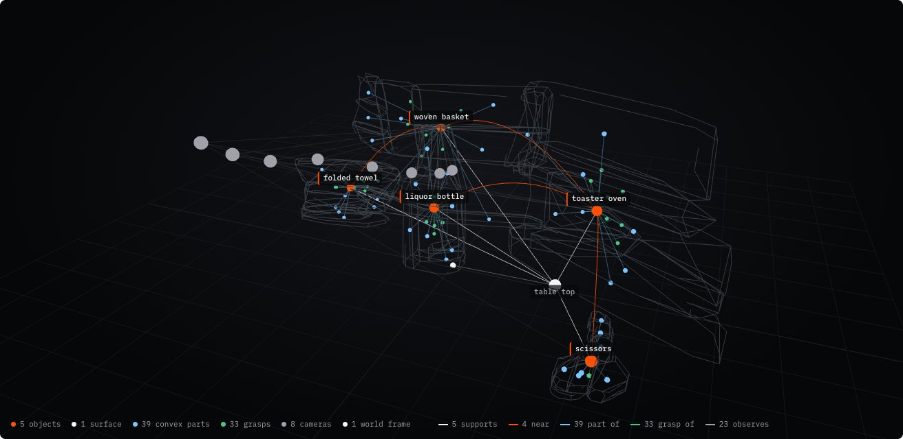
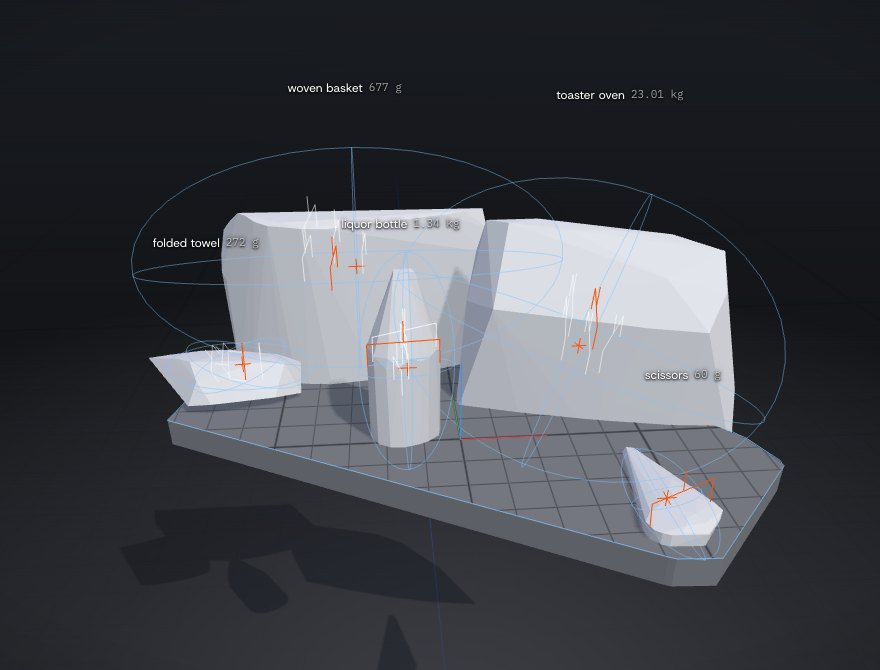

<h1 align="center">Darius</h1>

<p align="center">
  <b>A real-to-sim scene compiler.</b><br>
  One phone video of a tabletop in. A physically grounded, simulation-ready digital twin out:<br>
  every object separated, named, metrically scaled, given mass, inertia, friction and restitution,<br>
  annotated with grasp candidates and a 3D scene graph, and compiled to <b>MuJoCo</b>, <b>Isaac Sim (OpenUSD)</b>, <b>URDF</b><br>
  and a photo-real <b>browser simulator</b>.
</p>

<p align="center">
  <a href="https://github.com/DanielTong50/3d-visualization/actions/workflows/ci.yml"></a>
  <a href="https://danieltong50.github.io/3d-visualization/"></a>
  
  
  
  
  
</p>

<p align="center"></p>
<p align="center"><sub>Six of the ten demo scenes, rendered live in the browser from trained Gaussian splats. Every object in them is a rigid body.</sub></p>

## At a glance

| | |
|---|---|
| Input | 20–60 s of phone video. No markers, no depth sensor, no calibration |
| Output | A versioned scene package plus a robotics bundle: MJCF, URDF, OpenUSD, `world.json`, `scene_graph.json` |
| Objects detected and separated into 3D rigid bodies (Objectron, 24 clips) | **24 / 25** |
| Metric size within ±25% of ARKit ground truth | **88%** (median estimated / true size **0.99×**) |
| Appearance on held-out frames, retrained clips | **+2.2 dB** median PSNR over clone-and-split 3DGS on the same 9 clips, better on every one |
| Physics checks on every commit | MuJoCo settling of every scene, closed-form sliding (`v0²/2μg`) and bounce (`e²h`), UsdPhysics schema round trip, URDF compilation |
| Tests | 127 Python (pytest) · 53 TypeScript (Vitest) |

## How it works



The compiler is a **dependency graph of seven resumable stages**, each a pure function of a job folder. Stages
start as soon as their inputs exist, so reconstruction (GPU) and segmentation (API calls) run side by side, and so
do physical estimation and splat training. Any stage can be re-run alone, locally or on Modal.

| Stage | What happens | The idea that makes it work |
|---|---|---|
| **Ingest** | 48 time bins; the sharpest frame (variance of the Laplacian) wins each | The keyframe clip SAM tracks *is* the frame set VGGT reconstructs, so lifting 2D to 3D is a lookup |
| **Reconstruct** | [VGGT-1B](https://github.com/facebookresearch/vggt) predicts every camera and depth map in one forward pass (~2.5 s) | No SfM, no feature matching; portrait video keeps its full field of view |
| **Segment** | Muse Spark names and boxes each object; SAM 3.1 tracks those boxes through every keyframe | Box prompts are wording-independent, unlike concept prompts |
| **Lift** | RANSAC table plane near the objects defines gravity; a per-voxel majority vote across all views assigns labels | A mask that bleeds in one view is outvoted by the others |
| **Physics** | Recognized objects vote on metric scale (confidence-weighted median); mass = hull volume × density × fill fraction | Geometry is measured; models only supply priors, and every prior is schema-constrained and range-checked |
| **Appearance** | 3D Gaussian splatting (gsplat, MCMC densification, anti-aliased), cameras refined jointly; every Gaussian keeps its object label | Photo-real *and* separable: each object's splats ride on its rigid body |
| **Package** | Colliders (convex hull or CoACD parts), table outline, splat cleanup, then the robotics layer | One versioned contract between the compiler and every consumer |

<p align="center"></p>
<p align="center"><sub>The web app replays how each scene was built from the stage outputs it ships with: keyframes, VGGT's point cloud and camera path, SAM's masks, separated objects, physics estimates, the held-out render and the scene graph.</sub></p>

Every design decision, with the measurements behind it: **[docs/architecture.md](docs/architecture.md)**.

## Robotics

Every scan compiles to a robot environment in one +z-up world frame
([REP 103](https://www.ros.org/reps/rep-0103.html)), with the table top at z = 0.

```
scenes/kitchen-counter/robotics/
├── scene.xml          MuJoCo MJCF: free bodies, full inertia tensors, grasp sites, capture cameras, keyframe
├── scene.usda         OpenUSD + UsdPhysics: rigid bodies, MassAPI, convex-hull colliders, physics materials
├── urdf/*.urdf        one URDF per object (+ table) for PyBullet, Drake, Genesis, ROS tooling
├── world.json         poses, mass properties, grasps (body and world frame), camera intrinsics (OpenCV)
├── scene_graph.json   3D scene graph: surfaces, objects, convex parts, grasps, cameras and their relations
└── meshes/*.obj       collision geometry in each body's frame
```

- **Mass properties.** Exact volume integrals over the collision meshes (divergence theorem). Hollow objects
  carry their mass in a wall, modeled in closed form: the inertia per unit mass of the solid hull times
  k = (1 − s⁵) / (1 − s³) with 1 − s³ = fill fraction, which runs from 1 (solid) to 5/3 (thin shell).
- **Contacts.** Each object's friction and restitution are exactly its contact parameters against the table
  (geom priority in MJCF, PhysX combine modes in USD). Restitution maps to a MuJoCo damping ratio
  ζ = −ln e / √(π² + ln² e), with the contact time constant set so its natural period spans eight solver steps;
  a ball dropped in the exported scene rebounds to e² of its height (tested).
- **Grasps.** Antipodal parallel-jaw candidates (Nguyen, 1988) sampled on each collision hull: contacts inside the
  friction cone, fingertips clear of the table, approach as close to top-down as the closing axis allows,
  scored and de-duplicated. Exported as MJCF sites and in `world.json`.
- **3D scene graph.** Nodes for the table, each object (at its center of mass), its convex parts, its grasps and
  the capture cameras; edges `supports`, `near` (with the gap in meters), `part_of`, `grasp_of`, `observes`.

<p align="center"></p>
<p align="center"><sub>The kitchen counter's scene graph, as the web app draws it: 5 objects, 39 convex parts, 33 grasp candidates, 8 cameras, 105 edges. Drag to orbit, hover a node to see its relations.</sub></p>

```bash
uv run darius export ../scenes/kitchen-counter      # robotics/ + export.zip
uv run darius graph  ../scenes/kitchen-counter      # what supports what, what is near what
uv run darius sim    ../scenes/kitchen-counter      # simulate in MuJoCo, check it comes to rest
```

```python
import darius
from darius.robotics.sim import PushEnv

scene = darius.load_scene("scenes/kitchen-counter")
print([(o.label, o.mass_kg, len(o.grasps)) for o in scene.objects])

env = PushEnv(scene, target="obj_03")          # push the bottle to a goal, Gymnasium-style
obs, info = env.reset(seed=0)
obs, reward, terminated, truncated, info = env.step([0.1, 0.0])
```

The full reference, with derivations and simulator-specific notes: **[docs/robotics.md](docs/robotics.md)**.

## Browser simulator

**[Open the live demo →](https://danieltong50.github.io/3d-visualization/)** Ten real scans load instantly; no account,
no install. Grab, carry (Q / E to turn), throw and push objects; tap one for its physics and robotics card; change
its material; switch gravity; or ask "what if someone bumps the table?" (Muse Spark tool calling, validated
client-side).

<p align="center"></p>
<p align="center"><sub>Robot view (press 4): what the exporters write. Colliders, centers of mass, equivalent inertia ellipsoids and grasp candidates.</sub></p>

- **Rendering.** Spark renders the trained splats straight to the canvas, so they blend in the sRGB space they
  were trained in. Frames are drawn only when something changes (a moving body, the camera, a finished splat sort),
  and the pixel ratio adapts to hold the frame rate.
- **Physics.** Rapier (WASM) at a fixed 120 Hz, decoupled from rendering and kept in real time down to 5 fps.
  Held objects follow the pointer on an implicit spring whose stiffness scales with mass, so a 23 kg toaster and a
  34 g cup sag the same centimeter below the hand; releasing throws at the hand's measured velocity.
- **Four views.** Scene (the scan), Colliders (wireframes, frames, velocities, trails), Physics (only what the
  engine sees), Robot (mass distribution and grasps).

## Repository

```
pipeline/darius/            the Python package, in layers (a layer imports only from the ones above it)
  core/                     geometry, coordinate frames, materials, cross-process errors
  scene/                    the scene package contract: schema (Pydantic), asset I/O, compact JSON
  models/                   Meta Model API clients (Muse Spark, SAM 3.1)
  robotics/                 mass properties, grasps, scene graph, MJCF / URDF / USD writers, MuJoCo env
  pipeline/                 the seven stages and the job graph that runs them
  calibration/              real-to-sim friction measurement from a filmed push
  service/                  FastAPI service and "what if" planning
  eval/ · tools/            Objectron ground truth; gallery rebuild, validation
  cli.py                    the `darius` command
pipeline/modal_app.py       cloud deployment: GPU and CPU functions, warm VGGT, concurrent stage graph, web API
frontend/                   React + three.js + Spark + Rapier: simulator, pipeline replay, scene graph view
scenes/                     ten real scans and the hand-built reference scene, each with its robotics bundle
docs/                       architecture · robotics · scene format + JSON Schema · results · design · API notes
```

## Quick start

```bash
git clone https://github.com/DanielTong50/3d-visualization.git darius && cd darius

# Simulator only (no keys needed): opens the bundled scenes
cd frontend && npm ci && npm run dev

# Python package: the robotics layer and tools work offline
cd pipeline && uv sync
uv run darius info ../scenes/kitchen-counter
uv run pytest                                          # 127 tests, no GPU or network

# The compiler: needs a Meta Model API key, a Hugging Face token (VGGT-1B-Commercial) and Modal
cp ../.env.example ../.env                             # fill in the keys
uv run modal secret create darius --from-dotenv ../.env
uv run modal run modal_app.py --video ~/Movies/desk.mov --name desk   # writes scenes/desk
```

See [CONTRIBUTING.md](CONTRIBUTING.md) for the full workflow, including the evaluation.

## Evaluation

Evaluated end to end on **24 Objectron phone videos** (6 tabletop classes × 4 test-split clips) against
ARKit-measured metric 3D boxes, with no per-clip tuning ([docs/results.md](docs/results.md)). The reconstruction
has no scale of its own: an object's metric size is right only if detection, tracking, 3D separation, recognition
and scale estimation all worked.

| Metric | Result |
|---|---|
| Ground-truth objects detected and separated | 24 / 25 |
| Labels correct | 100% |
| Size within ±25% of ground truth | 88% |
| Median estimated / true size | 0.99× |
| Held-out PSNR, 9 retrained clips, MCMC vs. clone-and-split | 28.0 vs. 27.3 dB median, +2.2 dB median gain, better on all 9 |

<p align="center"></p>

## Models

| Model | Role |
|---|---|
| [VGGT-1B-Commercial](https://huggingface.co/facebook/VGGT-1B-Commercial) (Meta) | Cameras, depth and confidence in one forward pass; self-hosted on Modal |
| Muse Spark 1.3 (Meta Model API) | Detection with boxes; material, size and physics priors; "what if" tool calling |
| SAM 3.1 (Meta Model API) | Box-prompted video object tracking |
| [gsplat](https://github.com/nerfstudio-project/gsplat) 1.5 | 3D Gaussian splatting with MCMC densification and camera refinement |
| [CoACD](https://github.com/SarahWeiii/CoACD) | Approximate convex decomposition, kept only where it removes real empty space |

## Limitations

- **Undersides and interiors are never observed.** Colliders assume an object rests on the footprint of its lower
  half, and depth noise fills cavities (a mug's inside), so hulls treat them as solid. Grasp candidates are
  computed on convex hulls and can reach into a concavity the real object has: they are proposals for a planner.
- **Scale depends on recognizable objects.** Unfamiliar objects fall back to low-confidence votes (flagged in
  `scale_source`).
- **Baked lighting.** Splats keep the capture's lighting; the patch under a moved object is interpolated.
- **Splats are view-limited.** The surroundings are trained from the filmed side only; the viewer fades them out
  away from the capture path.
- **The reality check is validated on synthetic data only.** Glass, mirrors and polished metal break reconstruction.

## Acknowledgements

VGGT by Wang et al. (CVPR 2025), [VGGT License](https://github.com/facebookresearch/vggt/blob/main/LICENSE.txt).
Objectron by Ahmadyan et al. (CVPR 2021), used under the
[C-UDA 1.0](https://github.com/google-research-datasets/Objectron/blob/master/LICENSE) for evaluation and the demo
scans. MCMC densification: Kheradmand et al., *3D Gaussian Splatting as Markov Chain Monte Carlo* (NeurIPS 2024).
3D scene graphs: Armeni et al. (ICCV 2019), Hughes et al. (Hydra, RSS 2022), Gu et al. (ConceptGraphs, ICRA 2024).
Muse Spark, SAM 3.1 and the Meta Model API by Meta. Spark by World Labs; Rapier by Dimforge; three.js; MuJoCo by
Google DeepMind; OpenUSD by Pixar; Modal.

## License

[MIT](LICENSE) for the code in this repository. Model weights and datasets keep their own licenses (above).
