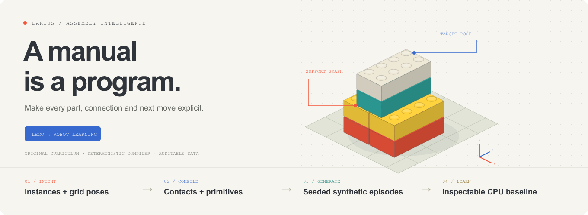
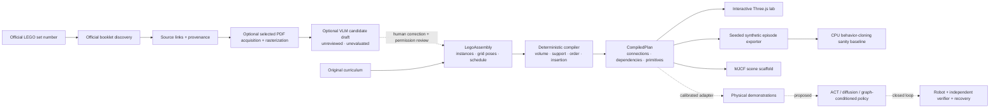

<div align="center">

# DARIUS

### From instructions to intelligence.

**A LEGO assembly compiler, an interactive robot lab, and a reproducible path from a build graph to training data.**

[](engine/darius/lego/compiler.py)
[](frontend/)
[](engine/darius/robotics/dataset.py)
[](engine/darius/robotics/train.py)
[](docs/robot-training.md)

[Run the lab](#run-the-lab) · [Compile a build](#a-complete-artifact-pipeline) · [Train the baseline](#a-complete-artifact-pipeline) · [Robot research plan](docs/robot-training.md) · [Architecture](docs/lego-architecture.md)

</div>



A LEGO manual is a compact program: introduce a part, align its connectors, attach it to the structure, repeat. Darius makes that program explicit. Every brick has an identity and a discrete pose; every intended connection has stud coordinates; every placement has dependencies and a nominal pick/place program. The same compiled artifact drives the 3D lab, dataset generation, and a small offline learning baseline.

The long-term goal is a robot that can read an assembly goal, build it, verify each connection, and recover from a mistake. This branch builds the inspectable foundation for that goal—and specifies the physical experiments needed to get there.

> **Works today:** original build → validated contact graph → Cartesian primitive program → interactive 3D preview → reproducible synthetic episodes → trained numeric sanity model. Official set-number lookup discovers public instruction booklets; an optional fetch/render/VLM path produces explicitly unapproved candidate drafts. Reliable manual reconstruction, learned visual manipulation, and physical robot execution remain research work.

## The demo in 90 seconds

1. Open the **Assembly lab** and choose **Signal tower**, **Stud bridge**, or **Gradient stairway**.
2. Play the build. The animated robot carries studded bricks from the indexed inventory tray to their target poses. Pause, step, scrub, orbit, and inspect the exploded assembly.
3. Switch between **Sequence**, **Graph**, **Inventory**, and **Plan**. Trace a placement from its brick identity to its support parents and primitive program.
4. Inspect the bridge: a single plate connects two support parents, with partial stud support explicitly reported by the compiler.
5. Look up official set **10698** to see the instruction-booklet discovery path. Public PDFs are linked from LEGO's source. The CLI can also fetch selected pages and request an unapproved VLM draft for review.
6. Download the compiled plan or synthetic training bundle. Use the CLI below to produce a hashed dataset and fit a real, inspectable offline baseline.

The robot animation is labeled **Kinematic preview**. Generated episodes are labeled as synthetic planning trajectories. A visual press and a `verify` command represent intended operations; neither is a measured successful insertion.

## Why LEGO is the right first domain

LEGO provides a discrete language for studying precise assembly: standardized part families, nominal stud/plate spacing, repeated connector patterns, visual step sequences, and compositional structures. Small builds expose the same hard problems as larger assemblies—part identity, occlusion, dependency ordering, contact, uncertainty and error recovery—inside an inspectable workspace.

A grid also creates strong constraints. Instead of asking a model to invent an unconstrained world, ask it for part identities and candidate poses, then check those hypotheses against known geometry. Deterministic checks can reject a floating brick or an impossible insertion before a robot moves.

That does not make LEGO manipulation easy. Submillimeter alignment, clutch engagement, finger access and contact forces are separate engineering problems. Darius records that boundary in its execution status rather than hiding it behind the render.

## System architecture



Solid arrows describe implemented software paths, including the optional unapproved VLM adapter. Dotted paths identify review boundaries, proposed integration and research. The VLM adapter has mocked-contract tests and one public-input smoke run; no official-manual reconstruction accuracy is claimed. The MJCF export is a primitive scene scaffold, not a complete robot-learning environment.

| Layer | Concrete artifact | Current behavior |
|---|---|---|
| Source | `LegoAssembly` | Original or reviewed source, instance inventory, discrete target geometry, step schedule |
| Compiler | `CompiledPlan` | Geometric diagnostics, explicit stud-contact graph, support parents, ten nominal primitives per placement |
| Frontend | Assembly lab | Procedural brick geometry, articulated robot preview, target ghosts, timeline and inspectors |
| Discovery | Instruction metadata | Official set-page lookup, multiple booklets, cached/live provenance, official PDF links |
| Manual draft | `candidate_draft` | Optional bounded PDF/page acquisition and schema-constrained VLM reading; uncertainty and review required |
| Data | `darius.synthetic.v1` | Seeded Cartesian references, whole-episode split, source hashes and checksums |
| Model | `model.npz` + `report.json` | NumPy ridge behavior cloning; held-out synthetic one-step error and simple baselines |
| Simulation | MJCF XML | Free primitive brick bodies, visual studs, goal sites and a mocap TCP marker |
| Physical learning | Experiment drafts | Rig/calibration plan, real dataset contract, ACT/diffusion baselines, evaluation and recovery protocol |

## A complete artifact pipeline

No model API key, robot, GPU, or internet connection is required for the compiler, curriculum, dataset generator, or numeric baseline.

```bash
# From the repository root
cd engine
uv sync --locked

# Inspect and compile the original curriculum
uv run darius lego library
uv run darius lego compile signal-tower --out ../outputs/tower-plan.json

# Generate deterministic references and an auditable train/validation split
uv run darius lego dataset signal-tower \
  --out ../outputs/tower-data --episodes 24 --seed 7 --fps 10

# Train a small offline model and evaluate whole held-out episodes
uv run python -m darius.robotics.train ../outputs/tower-data \
  --out ../outputs/tower-baseline

# Export a simulator scene scaffold
uv run darius lego sim signal-tower --out ../outputs/tower-scene.xml
```

Use a new output directory for each dataset/model run; those exporters refuse nonempty destinations.

```text
outputs/
├── tower-plan.json
├── tower-data/
│   ├── assembly.json             original task + source declaration
│   ├── compiled-plan.json        exact compiler result
│   ├── manifest.json             units, features, split, seed, provenance, limitations
│   ├── episodes/0000.jsonl       timestamped state / goal / phase / action
│   ├── episodes/...
│   └── checksums.json            SHA-256 integrity record
├── tower-baseline/
│   ├── model.npz                 weights + training-only normalization
│   └── report.json               per-channel error + zero/mean-action comparisons
└── tower-scene.xml                nominal MJCF fixture
```

The baseline predicts a five-component per-frame delta: XYZ position, yaw, and gripper opening. Its inputs contain the current reference state, known primitive goal, phase, and progress. It demonstrates that the representation can pass through data generation, integrity checks, split validation, training and artifact export.

**Its error is open-loop synthetic prediction error.** It does not measure vision, grasp success, physical dynamics, insertion force, closed-loop rollout, or transfer to an actual arm. Darius JSONL is an explicit project interchange format; conversion to LeRobotDataset v3 requires a separate adapter and appropriate real or rendered sensor data.

## Run the lab

```bash
# Terminal 1 — frontend, from repository root
cd frontend
npm ci
npm run dev
# Open the Local URL printed by Vite.
```

The three original builds are checked-in fixtures, served locally and copied into production builds. Core scene playback and plan inspection work without the API. Each build also includes a small pre-generated `training.json` bundle (two synthetic episodes at 5 Hz, seed 7), so the default lab can export actual synthetic records offline. The API can generate a larger requested bundle.

```bash
# Terminal 2 — optional local API, from repository root
cd engine
uv run uvicorn darius.service.api:local_app --factory --host 127.0.0.1 --port 8787

# Terminal 1 — point a restarted frontend at this API
VITE_API_URL=http://127.0.0.1:8787 npm run dev
```

The compiler, library, metadata and synthetic-data endpoints do not call a paid model. The optional manual-draft endpoint does. The retained furniture perception demos use separate model credentials documented in [the archive](docs/furniture-archive.md).

## Public manuals, without an upload

Search by set number first. LEGO provides freely downloadable instructions for thousands of sets on its official service, and the lookup adapter extracts booklet metadata from that source. Coverage varies; some sets have multiple booklets, alternate builds or additional material. [LEGO's download guidance](https://www.lego.com/en-us/service/help-topics/article/how-to-download-building-instructions-online).

```bash
cd engine
uv run darius lego instructions 10698              # checked-in metadata snapshot
uv run darius lego instructions 10698 --refresh    # live official lookup
uv run darius lego instructions 10698 --out ../outputs/instructions-10698.json
```

Each result exposes `retrieval`, `retrieved_at`, booklet sequencing, `semantic_status: "not_parsed"`, and `training_rights: "permission-required"`. The server accepts a validated set number, constructs a fixed official URL, caps the response size, sets a timeout, disables redirects, and returns only recognized official asset links. It does not fetch arbitrary submitted URLs or include copied manuals in the checked-in demo corpus.

### Optional upload-free manual draft

The acquisition CLI can download a selected official booklet, render a bounded page selection, and record the PDF/page hashes. `draft-set` then calls the configured vision-language model to propose part identities and grid poses. This path needs internet access, the optional PDF renderer, and `MODEL_API_KEY` for the paid model call.

```bash
cd engine
uv sync --locked --extra manuals

# Acquisition + rasterization only; no model call.
uv run darius lego fetch 10698 --booklet 4 --pages 1,2,3 \
  --out outputs/camera-manual

# Optional paid model call: fetch selected pages and emit an unapproved draft.
uv run darius lego draft-set 10698 --booklet 4 --pages 1,2,3 \
  --out outputs/camera-draft
```

Booklet numbers are one-based positions in the lookup result; inspect them before selecting. The acquisition writes `source.pdf`, `page-NNN.png` and `acquisition.json`; `draft-set` additionally writes `draft.json`. A page subset remains labeled as a partial document. These local source artifacts belong in ignored outputs, not the distributable curriculum.

The model emits evidence, source-page references, uncertainty and self-assessed confidence. Missing/unsupported part identities or poses remain unresolved. A complete candidate is compiled independently, but stays `requires_review: true` and `review_status: "pending"`; geometric validity does not approve it. Imported training material also requires a documented permission reference. Contract tests use a stubbed model; one real public-input inference run is described below. Reliable manual-to-3D reconstruction remains an experiment to evaluate. MEPNet and the recent JARVIS benchmark are directly relevant prior work; Darius' contribution here is a transparent compiler/data workflow that can support such research. [MEPNet](https://arxiv.org/abs/2207.12572), [JARVIS](https://arxiv.org/abs/2610.27618).

### A real public-input smoke run

The optional path was exercised against official set **10698**, alternate camera booklet **4**: a **10-page**, **1,355,398-byte** PDF, with pages **3–5** rendered and sent to Muse Spark 1.3 at high reasoning effort. The model returned **10 draft brick entries**. Unsupported part geometry and unresolved features prevented a complete candidate: **`candidate: null`, `compiled: null`, `requires_review: true`**.

That run demonstrates real retrieval, page rendering, model inference and withholding an incomplete program. It does not demonstrate correct reconstruction of the booklet or a complete official set. Downloaded PDF/pages and raw draft remain ignored local outputs; copyrighted pages are not included in this repository. The source PDF SHA-256 was `3273ce0e51eb19bf463a51bd6b29147aeaa18da12f782c4542c9134ff1daceb6`.

Public viewing is separate from rights to redistribute or train on source content. LEGO identifies its instructions as copyrighted. The distributable demo builds are original, and third-party training sources need their own recorded permission basis. [LEGO Fair Play](https://www.lego.com/en-us/legal/notices-and-policies/fair-play).

## The compiler, precisely

The source frame is right-handed, **+Y up**. X/Z are integer stud coordinates with nominal **8 mm** pitch; Y is an integer plate coordinate with nominal **3.2 mm** pitch. `position` describes the minimum footprint corner and body-bottom height above the baseplate. Quarter turns rotate the footprint. Every brick instance appears exactly once in the build schedule.

```json
{
  "id": "b01",
  "part_id": "3001",
  "color": "coral",
  "color_hex": "#f4553b",
  "studs": [2, 4],
  "height_plates": 3,
  "position": [6, 0, 4],
  "rotation": 0
}
```

The compiler checks known rectangular part dimensions, bounds, occupied-volume intersections, earlier stud support, and obstructions to nominal vertical insertion. It derives exact overlapping stud cells and a dependency graph, then emits:

```text
approach tray → descend → grasp → lift → transfer
             → align → press → release → retract → verify
```

Tray-source yaw and assembled-target yaw are explicit: pickup/lift preserve source orientation, then the elevated transfer adopts the target quarter turn. Brick-center poses, TCP references and baseplate height stay distinct across the compiler, preview and scene export.

Support coverage is a geometric ratio, not a stability guarantee. A `press` primitive contains an uncalibrated placeholder force limit, not measured force. Every compiled plan remains `simulation_only` with explicit robot/calibration/IK/collision/force blockers. See [the technical architecture](docs/lego-architecture.md) and [generated JSON Schema](docs/lego.schema.json) for formulas, schema semantics and implementation boundaries. `darius lego schema` prints the source-task schema.

### The original curriculum

These are exact counts computed from the checked-in catalog—not learned-model accuracy or physical success metrics.

| Build | Bricks | Contact edges¹ | Contact stud cells | Primitives | What it exercises |
|---|---:|---:|---:|---:|---|
| Signal tower | 6 | 9 | 40 | 60 | Cross-bonded courses and repeated part instances |
| Stud bridge | 6 | 7 | 28 | 60 | Multiple support parents and partial support |
| Gradient stairway | 6 | 6 | 48 | 60 | Height-conditioned placement and dependency chains |

¹ Includes contacts to the baseplate. Each preview has an authored nominal duration of 30.6 s; this is not measured robot throughput. These builds are independent original tasks, not reconstructions of official LEGO sets.

## From this prototype to a real robot

The proposed first physical experiment uses one brick, an indexed source tray and a fixed baseplate. Calibrate the fixture, camera and TCP; measure grasp repeatability; implement a guarded controller; record synchronized observations and executed actions; then train an ACT baseline on real demonstrations. Extend to multiple targets and only then to complete builds.

The research plan specifies:

- A hardware adapter boundary for measured observations, collision-checked motion, possession checks, guarded pressing and stops.
- A synchronized dataset contract with camera frames, actual joint state, controller actions, contact validity, independent seating labels and provenance.
- A staged curriculum, whole-episode/session/build holdouts, and matched ACT/diffusion comparisons.
- Graph-conditioned policy and recovery experiments, with ablations that separate perception, planning, manipulation and verification.
- Complete-build success, structural correctness, interventions, retry budgets, measured force and confidence intervals.

Read [robot-training.md](docs/robot-training.md) and the explicitly marked [ACT](training/act-real-draft.yaml) / [curriculum](training/curriculum-draft.yaml) drafts. They are engineering specifications, not claims that an ACT model or physical LEGO robot has been trained in this repository.

## API

All paths below are relative to the local FastAPI server. Interactive OpenAPI documentation is at `/docs`.

| Method | Path | Result |
|---|---|---|
| `GET` | `/lego/library` | Original build summaries and compiler counts |
| `GET` | `/lego/builds/{id}` | Full compiled task including source assembly |
| `POST` | `/lego/compile` | Schema-validated assembly → diagnostic compiled plan |
| `GET` | `/lego/instructions/{set_number}?refresh=false` | Official booklet metadata; no PDF reconstruction |
| `GET` | `/lego/builds/{id}/training?episodes=4&seed=7&fps=10` | Synthetic bundle with manifest and episodes |
| `POST` | `/lego/manual-drafts` | Ordered page images → unapproved VLM candidate; model credentials/access gate apply |

A syntactically valid source can still compile to `validation.valid: false`; API consumers must inspect that field. Exporters reject geometrically invalid plans. Episode generation is bounded and deterministic. See [architecture](docs/lego-architecture.md) for the exact feature contract.

```bash
curl http://127.0.0.1:8787/lego/builds/bridge
curl http://127.0.0.1:8787/lego/instructions/10698
curl -X POST http://127.0.0.1:8787/lego/compile \
  -H 'Content-Type: application/json' \
  --data-binary @assemblies/lego/signal-tower/assembly.json
```

## Repository map

```text
engine/darius/
  lego/                 typed grid IR, compiler, official discovery/acquisition, optional VLM drafts
  robotics/             synthetic episodes, hashing, CPU sanity training, MJCF scaffold
  service/              FastAPI LEGO endpoints + retained perception endpoints
  assembly/             prior furniture graph, tracker and guidance
  perception/           prior manual/video/part perception pipeline
frontend/src/
  lego/                 LEGO lab types, data, rendering and interactions
  pages/                LEGO workbench + retained furniture demos
assemblies/lego/
  signal-tower/         assembly.json + plan.json + training.json
  bridge/
  stairway/
  instructions/         official metadata snapshot; no bundled PDF manual
  index.json
docs/
  lego-architecture.md  representation, compiler, data and simulation boundaries
  robot-training.md    actionable physical-learning experiment specification
  research-sources.md  verified primary-source ledger
  furniture-archive.md prior README and its historical benchmark context
training/               explicitly marked experiment/curriculum draft YAML
```

## Verification

```bash
cd engine
uv run pytest -q
uv run ruff check .
uv run ruff format --check .
uv run darius lego export --out ../outputs/lego-fixture-check

# Optional PDF/simulator dependencies and runtime tests
uv sync --locked --extra manuals --extra simulation
uv run pytest -q

cd ../frontend
npm run typecheck
npm test
npm run build
npm run format:check
```

The verified branch snapshot on 2026-10-29 passed **98 engine tests** and **67 frontend tests**. The engine suite exercises compiler validity/failure cases, public metadata parsing/acquisition, draft handling, API contracts, deterministic data generation, episode splits, units, hashes, baseline training and scene export. Optional MuJoCo 3.17.0 checks loaded each original scene and stepped 500 × 0.002 s (1 s) with finite state; this checks scene/runtime compatibility. Frontend tests cover the existing assembly engine and LEGO data/playback behavior. Browser checks should include playback, inspection, export, instruction lookup, and narrow-screen layout. The complete offline compile → four-episode export → integrity-checked baseline training → MJCF runtime path was exercised for all three original builds. Canonical JSON exports match the checked-in fixtures, and all four retained furniture benchmark results still re-score. A render is evidence of UI behavior, not robot capability.

## Limits and next milestones

- **Geometry:** only the supported upright rectangular brick/plate curriculum. No arbitrary LDraw import, hinges, Technic pins, flexible elements, nonvertical assembly or general grasp planning.
- **Collision:** target volumes and nominal insertion checks; full robot/gripper swept-volume collision checking and IK remain hardware-adapter work.
- **Perception:** official acquisition and an optional unapproved VLM adapter are implemented. Reconstruction quality is unevaluated; arbitrary official builds, unsupported geometry and LEGO camera tracking remain unsolved.
- **Physics:** browser motion is kinematic; MJCF is a loadable primitive scene without a robot arm or clutch model.
- **Learning:** the runnable model is a numeric synthetic sanity baseline. Visual ACT/diffusion training, LeRobot conversion, physical collection and measured insertion success remain proposed work.
- **Generalization:** held-out synthetic episodes vary translation and timing within the same build. No unseen-set or physical-generalization claim is made.

Next: evaluate the manual-draft adapter against reviewed ground truth; build a calibrated single-brick physical rig; add independent seating verification; record a real dataset and ACT baseline; then study graph-conditioned recovery. The evidence should grow from one real connection outward.

## Research and history

The design builds on manual-to-plan reconstruction, action-chunk imitation learning, visual robot assembly benchmarks and standard simulation/data tooling. The [source ledger](docs/research-sources.md) links primary references and distinguishes their findings from this project's capabilities.

The prior furniture copilot, stored model runs and evaluation tooling are retained. Its README and measured results are preserved in [the furniture archive](docs/furniture-archive.md); those scores are not LEGO results. Darius' earlier real-to-sim scene compiler is preserved at the [`v0.2.0` tag](https://github.com/DanielTong50/3d-visualization/tree/v0.2.0).

Code and original project materials are provided under [MIT](LICENSE). Third-party manuals, marks, models and datasets retain their respective rights. Darius is an independent project and is not affiliated with or endorsed by the LEGO Group.
