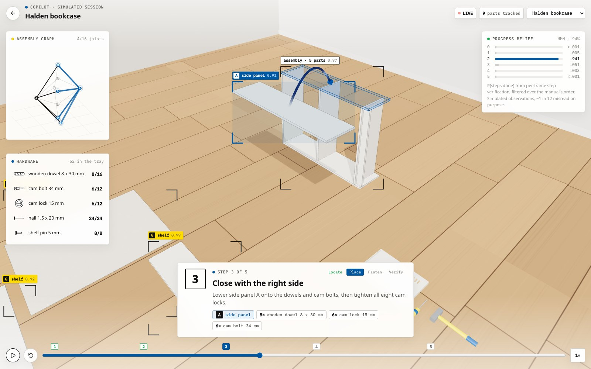
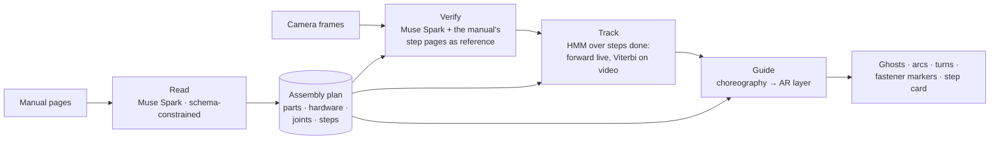

<h1 align="center">Darius</h1>

<p align="center">
  <b>An AR copilot for flat-pack furniture.</b><br>
  Show it the manual: it reads the pages into an <b>assembly graph</b> of parts, hardware, joints and steps.<br>
  Point the phone at the build: it tracks your progress through that graph from the camera,<br>
  and draws the next move in place: which part, where it goes, which way to turn the piece, where every screw goes in.
</p>

<p align="center">
  <a href="https://github.com/DanielTong50/3d-visualization/actions/workflows/ci.yml"></a>
  <a href="https://danieltong50.github.io/3d-visualization/"></a>
  
  
  
  
  
</p>

<p align="center"></p>
<p align="center"><sub>The copilot on step 3 of a bookcase: the part that goes on now is boxed in orange with a ghost at its target, loose parts are tracked in cyan, the assembly graph fills in (left) and the tracker's belief over "steps done" (right) comes from per-frame step verification.</sub></p>

## At a glance

Every number below is a stored run of `darius eval` on the furniture library (Muse Spark 1.3, 2026-10-28), replayed
by the [demos](https://danieltong50.github.io/3d-visualization/) and re-scored on every commit by CI.

| | Halden bookcase | Varde nightstand | Lund side table | Ostra desk |
|---|---:|---:|---:|---:|
| Size: parts · joints · steps | 9 · 16 · 5 | 10 · 15 · 6 | 9 · 12 · 4 | 5 · 7 · 3 |
| **Manual → graph**: parts F1 | 100% | 100% | 100% | 100% |
| Edges (joints) F1 | **100%** | **96.8%** | **100%** | **100%** |
| Steps read exactly | 100% | 83.3% | 100% | 100% |
| Hardware counts | 100% | 100% | 100% | 100% |
| **Video → timeline**: build steps found | **5 / 5** | **6 / 6** | **4 / 4** | **3 / 3** |
| Frames with the right progress | 91.2% | 85.1% | 93.8% | 88.9% |
| Mean error dating each step | 0.49 s | 1.20 s | 0.63 s | 0.90 s |

The one joint the manual reader got wrong in four manuals: it also nailed the nightstand's back panel to the top.
The model reads all of a manual in 35–70 s; a 60 s video takes about 30 s to decode (15 requests, 6 at a time).

## How it works



A manual is a graph in disguise. **Parts** (the lettered panels, legs and shelves) are nodes; **joints** (two parts
held by dowels, cam locks, screws, nails or a groove) are edges; **steps** put the edges in order and say how the
piece lies while you work. Darius recovers that graph, tracks your progress through it, and turns its geometry into
guidance.

| Stage | What happens | The idea that makes it work |
|---|---|---|
| **Read** (`perception/manual.py`) | All pages go to Muse Spark in one request with a JSON schema: parts by letter with counts, hardware by article number, and for every step the parts brought in, the hardware box, the build orientation drawn and every pair of parts joined | The model only reads; `to_plan` builds the graph. Repeated letters become instances (`A1`, `A2`), each connection resolves to the piece brought in now, then one not yet paired, then the least joined, and the part a step builds on comes in even when it is drawn without an arrow. `validate` reports anything that does not add up |
| **Verify** (`perception/frames.py`) | A few consecutive frames per request, with the plan's parts, what the build looks like after every step, **and the manual's step pages as reference images**; the model says which steps are done, how sure it is, which letters are joined and loose, and how the piece lies | Comparing the frame with the manual's own drawings: on the bookcase, scored the same way, it lifted the frames with the right progress from 81% to 91% and cut the mean timing error from 2.4 s to 0.5 s (the face-down back panel was missed without them) |
| **Track** (`assembly/tracking.py`, mirrored in `engine/tracking.ts`) | A hidden Markov model over *k*, the number of steps done. Live, the forward algorithm updates the belief after every frame; for a whole video, Viterbi gives the most likely build history and forward-backward its confidence | A build follows the manual: transitions stay (.86), advance (.11), rarely skip (.02) or undo (.01). Each frame's P(step done) is capped to [.15, .85] and tempered by .7, so one misread frame cannot move the build |
| **Guide** (`engine/choreography.ts`, `three/Stage.ts`) | Every instant of the build is computed from the plan: turn the piece to the step's orientation, locate the parts, carry them on arcs to their poses, fasten, verify | Subassemblies built on the side (a drawer box, a table's second frame) wait beside the work and join when their step comes; fastener markers come from each joint's hole pattern; detection boxes are the parts' projected geometry |

### The assembly plan

One Pydantic schema (`engine/darius/assembly/schema.py`, exported as [`docs/plan.schema.json`](docs/plan.schema.json),
mirrored in [`frontend/src/engine/plan.ts`](frontend/src/engine/plan.ts)) is produced three ways and compared on
equal terms: procedurally with exact geometry (the ground truth), by reading a manual, and as a timeline by watching a
video.

```jsonc
// assemblies/halden-bookcase/plan.json (abridged)
{
  "parts":    [{ "id": "A1", "label": "A", "name": "side panel", "size_mm": [18, 1060, 280], "assembled": {…}, "layout": {…} }, …],
  "hardware": [{ "id": "116952", "name": "cam lock 15 mm", "kind": "cam_lock", "count": 12 }, …],
  "joints":   [{ "id": "J1", "parts": ["B", "A1"], "kind": "cam_lock",
                 "hardware": [{ "id": "101350", "count": 2 }, …],
                 "fasteners": [{ "hardware": "118331", "position": [-382, 1051, -35], "axis": [-1, 0, 0] }, …] }, …],
  "steps":    [{ "index": 1, "title": "Top and bottom onto the left side", "parts": ["A1", "B", "C"],
                 "joints": ["J1", "J2"], "orientation": "on_side", "tools": ["screwdriver"], … }, …]
}
```

The algorithms, with their numbers, are in [docs/architecture.md](docs/architecture.md). Graph scores
(`assembly/graph.py::compare`) count parts and joints **by letter**: which of two identical side panels
is `A1` is arbitrary, so edges are compared as multisets of letter pairs.

## The furniture library: ground truth from geometry

`engine/darius/furniture` is a small **flat-pack compiler**. A product is declared as boxes with millimeter sizes and
positions; `FurnitureBuilder` finds every contact from the geometry, lays out hardware per joint kind (a cam-lock
joint is dowel, cam bolt, cam bolt, dowel; nails every ~15 cm), assigns each part a spot on the floor, and checks the
plan. The library has four products: a bookcase built on its side and nailed face down, a nightstand whose drawer is
built separately and slid in, a side table made of two frames and turned upside down for its top, and a desk.

From each plan, the web app **generates its manual**: hidden-line drawings in the flat-pack style
([`three/ManualArt.ts`](frontend/src/three/ManualArt.ts)), a parts page, a hardware page and a page per step with
letter callouts, arrows and the hardware box. Parts come off along a *free* way in: away from the part they join,
unless parts already in place block the sweep (shelves between two sides slide in from the front, the drawer comes in
from the front as one piece). And it **films each build** as a handheld session with frame-exact ground truth.
Those pages and videos are what the models are tested on (`frontend/scripts/capture.mjs`).

<p align="center"> &nbsp; </p>

## Demos

| | |
|---|---|
| [**Copilot session**](https://danieltong50.github.io/3d-visualization/?view=ar) · a whole build guided, with tracked parts, ghosts and arcs, turns, fastener markers, the graph and the tracker's belief (simulated perception, one frame in twelve misread on purpose) |  |
| [**Manual reader**](https://danieltong50.github.io/3d-visualization/?view=manual&furniture=varde-nightstand) · a real run replayed: each page is scanned while the model's structured output fills in and the graph grows edge by edge, then it is scored against the plan |  |
| [**Video analyzer**](https://danieltong50.github.io/3d-visualization/?view=video) · a filmed build with the model's reading of every sampled frame, the evidence heatmap, the decoded build history against the truth, and every joint dated |  |
| [**Live**](https://danieltong50.github.io/3d-visualization/?view=live) · your camera: pick a library product or photograph a manual (read into a plan by the API), then build; a frame is checked every few seconds and the tracker runs in the browser. A video file or a filmed build can stand in for the camera |  |

## Repository

```
engine/                     Python 3.11 (uv): the copilot's brain
  darius/assembly/          schema, graph ops (validate, subassemblies, compare), HMM tracker, guidance
  darius/furniture/         the flat-pack compiler and the four-product catalog
  darius/models/            Muse Spark client (schema-constrained JSON, retries)
  darius/perception/        manual pages -> plan · frames -> evidence · video -> timeline
  darius/eval/              darius eval: run, store and score the models on the library
  darius/service/           FastAPI: /library, /manuals, /frames, /videos
  modal_app.py              the API on Modal (CPU, scale to zero)
frontend/                   React 19 + three.js, TypeScript
  src/engine/               plan types, graph ops, the tracker (TS mirror), choreography, results
  src/three/                the workshop stage and AR layer · manual line art
  src/pages/                Home · copilot session · manual reader · video analyzer · live
  scripts/capture.mjs       renders manual pages, session videos and posters with Playwright
assemblies/                 the library: plan.json, manual pages, session.mp4 + truth.json,
                            stored model outputs (reading.json, analysis.json), benchmarks.json
docs/                       architecture.md · plan.schema.json · API notes
```

## Run it

```bash
# Engine
cd engine && uv sync
uv run darius library                      # the products
uv run darius show halden-bookcase         # a plan and its graph, step by step
uv run pytest -q                           # 28 tests, no API calls
uv run darius eval --check                 # stored model results re-score to the published numbers

# With a Meta Model API key in ../.env (see .env.example)
uv run darius manual ../assemblies/ostra-desk/manual --truth ostra-desk   # read a manual, score it
uv run darius track video.mp4 --plan halden-bookcase                      # decode a build video
uv run darius eval                                                        # re-run the whole benchmark

# Web app
cd frontend && npm ci && npm run dev       # http://localhost:5173
npm test                                   # 28 tests
node scripts/capture.mjs                   # regenerate manual pages and session videos

# API (live mode)
cd engine && uv run uvicorn darius.service.api:local_app --factory --port 8787
cd frontend && VITE_API_URL=http://127.0.0.1:8787 npm run dev
cd engine && uv run modal deploy modal_app.py
```

## Limits, honestly

- **The test data is generated.** Manuals are drawn from plans and sessions are rendered: real manuals are wordless
  and denser, and real videos have hands, clutter, motion blur and hardware the size of a fingernail. The pipeline is
  built for real input (live mode takes photographed pages and a phone camera), but the published numbers are on the
  library.
- **"Done" means the parts are in place.** Nothing visible happens in a rendered session while a step is fastened,
  so a step counts as done in video once its parts sit where they belong; the copilot's verify phase is where the
  fastening is checked with the person.
- **On these sessions the tracker does not raise frame accuracy**: the model's readings were already consistent from
  frame to frame. What it adds is a monotone build history with a confidence for every moment, and robustness when a
  frame is misread, which the tests and the copilot demo exercise with injected misreads.
- **Live mode answers in about 5 s per check** (one Muse Spark call with the step pages as reference), fine for
  furniture, where a step takes minutes, and too slow for anything faster.

## History

Darius 0.2 was a real-to-sim scene compiler for robotics (phone video to MuJoCo, OpenUSD and a browser simulator);
it is preserved at the [`v0.2.0`](https://github.com/DanielTong50/3d-visualization/tree/v0.2.0) tag. Darius 1.0 is the
assembly copilot: see the [changelog](CHANGELOG.md).

## License

MIT. See [LICENSE](LICENSE).
