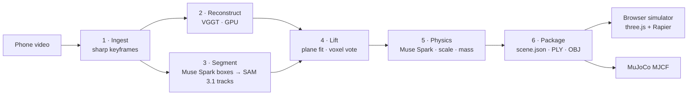
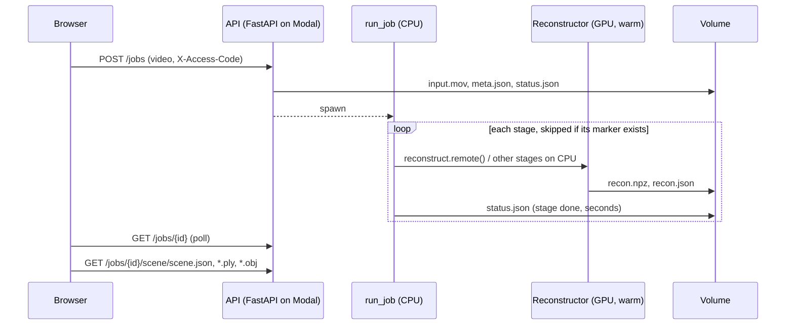

# Architecture

Scan2Sim turns a 20–60 second phone video of a tabletop into a *simulation-ready* scene: every
object separated, named, metrically scaled, and given mass, friction and restitution. This document
explains how, and why each design decision was made.

## Design principles

1. **One contract.** The pipeline and the simulator share nothing but the
   [scene package format](scene-format.md). The simulator was built and tested against a hand-written
   scene before the pipeline existed, and that scene still runs in CI.
2. **Every stage is a pure function of a folder.** A stage reads earlier outputs from the job folder
   and writes its own, ending with a marker file ([`jobs.py`](../pipeline/scan2sim/jobs.py)). A failed or
   changed stage re-runs alone (`--start physics`) without paying for the GPU stage again.
3. **Models propose, geometry decides.** Foundation models are used where they are strong (recognition,
   segmentation, priors about the world); everything that can be *measured* from the reconstruction is
   measured. Mass is computed from volume, not guessed; model outputs are schema-constrained, then
   range-checked.
4. **Measure everything that can be measured.** The pipeline is evaluated against metric ground truth
   ([results](results.md)), and the physics engine against closed-form mechanics (tests).

## Stage by stage

### 1 · Ingest ([`frames.py`](../pipeline/scan2sim/frames.py))

Candidates are decoded at 12 fps, split into 48 equal time bins, and the sharpest frame (variance of
the Laplacian) wins each bin. Bins whose best frame is under 30% of the median sharpness are dropped
rather than polluting reconstruction. Too-short, too-dark and mostly-blurry videos are rejected with
an actionable message (`InputError`), which the processing screen shows verbatim.

The selected frames are re-encoded as a short H.264 clip. **Frame *i* of the clip SAM tracks is frame
*i* that VGGT reconstructs**: that one-to-one correspondence turns lifting 2D masks into 3D from a
search problem into a lookup.

### 2 · Reconstruct ([`reconstruct.py`](../pipeline/scan2sim/reconstruct.py))

[VGGT](https://github.com/facebookresearch/vggt) (Wang et al., CVPR 2025) predicts camera poses, depth
and confidence for all keyframes in a single feed-forward pass: no feature matching, no bundle
adjustment. On an L40S, 26–48 frames take about 2 s of inference and 8 GB peak memory. World points
come from depth + cameras, which the VGGT authors report as more accurate than the point-map head.

Details that matter:

- Frames are resized to a 518 px long side with both sides multiples of the 14 px ViT patch, **without
  cropping**. VGGT's own loader center-crops portrait images, which discards a third of a phone video's
  field of view.
- The model runs in a warm Modal class (`Reconstructor`): weight loading is ~45 s, inference ~2 s, so
  a container stays up for 5 minutes between jobs.
- Weights: `facebook/VGGT-1B-Commercial` (the original `VGGT-1B` weights are CC BY-NC).

### 3 · Segment ([`segment.py`](../pipeline/scan2sim/segment.py))

The sharpest frame in the middle half of the video is the keyframe. **Muse Spark** lists each movable
object on the table with a short label and a box on its 0–1000 grid (structured JSON output).
**SAM 3.1** receives those boxes as *box prompts* on the keyframe and propagates masks forward and
backward through the clip under our own object ids.

Why boxes rather than SAM's text prompts: live testing showed SAM 3.1's concept prompts are very
sensitive to wording ("mandarin orange" finds nothing where "orange" finds all six) and cannot take a
generic prompt ("object" finds nothing), while Muse Spark's labels vary between runs. Box prompts make
the handoff wording-independent. Masks are rasterized at reconstruction resolution into per-frame
label maps; where masks overlap, the more confident one wins.

### 4 · Lift ([`lift.py`](../pipeline/scan2sim/lift.py), [`geometry.py`](../pipeline/scan2sim/geometry.py))

Each VGGT point comes from exactly one pixel of one keyframe, so it arrives already labeled. The
problem is noise, not association:

1. **Confidence filter:** drop the lowest 30% of VGGT depth confidence.
2. **Gravity.** RANSAC fits the table plane to *background points near the objects* (within 2.5× the
   objects' 90th-percentile radius), so a wall or the floor cannot win. The normal is oriented toward
   the mean camera center, because cameras filming a tabletop are above it, and the scene is rotated
   so the table is y = 0 with +y up. Diagnostics record the inlier RMS and the fraction of cameras
   above the table (should be 1.0).
3. **Multi-view voting.** Points are voxelized (0.4% of the median camera distance) and each voxel
   takes a label by majority vote over every point that fell in it, from every frame. It needs at least
   half the votes. A mask that bleeds onto the table in one view is outvoted by the views where it
   didn't.
4. **Cleanup per object:** discard points within 2× the plane threshold of the table, remove
   statistical outliers (16-NN), keep the largest 26-connected voxel component. Objects with fewer
   than 300 points stay in the background rather than becoming junk rigid bodies.

### 5 · Physics ([`physics.py`](../pipeline/scan2sim/physics.py))

For each object, Muse Spark sees three crops from well-separated frames with everything outside the
mask dimmed, and returns (JSON-schema constrained): category, material, **typical dimensions**,
typical mass, hollowness, fill fraction, friction, restitution, fragility, and confidence.

**Metric scale.** VGGT reconstructs up to an unknown scale. Each confidently recognized object votes
for one: `scale = median(sorted expected dims / sorted measured dims)`. Matching by rank sidesteps
"which side is the length", and the median of three ignores one badly measured side. The scene scale
is the confidence-weighted median of the votes, so one misrecognized object can't capture it. On the
two-mug scene the two independent votes agree to within 2.5%; across 24 Objectron clips the median
size error is 1% (see [results](results.md)).

**Mass** is computed, not guessed: `convex-hull volume × material density × fill fraction`, with
density from the shared [material table](../pipeline/scan2sim/data/materials.json). The model's direct
mass guess is only a sanity check: if they disagree by more than 2.5×, the typical mass wins and
`physics_notes` says why.

**Supporting base.** Cameras circling above a table barely see an object's lower edge, and
reconstructions are sparse and one-sided there. Projecting only the lowest ring of points made a
scanned mug's base coin-sized, and it tipped over in MuJoCo. The collider now gets the footprint of
the object's lower half projected onto the table, which is the physically sensible support prior
(`geometry.complete_bottom`).

### 6 · Package ([`package.py`](../pipeline/scan2sim/package.py))

Everything is converted to meters once. Each object's points and hull are written in object-local
coordinates (origin at the bounding-box center) so a simulator can attach them to a rigid body
directly. Hulls are capped at 32 vertices by farthest-point sampling: at 96, a scanned mug's many tiny
near-coplanar faces kept it rocking forever in Rapier; at 32 it settles and sleeps within 3 s.
The keyframe's segmentation overlay becomes the gallery thumbnail. `scan2sim.export` writes MuJoCo
MJCF from the same package.

## Runtime

- **Compute:** stages are separate Modal functions with their own images: VGGT pins torch 2.3.1 and
  numpy < 2, so it is isolated from the CPU image. Every function has a timeout. The GPU request is a
  fallback list (`L40S → A100-40GB → L4`).
- **State:** a Modal Volume holds job folders; weights are cached in a second volume.
- **Errors:** third-party exceptions don't survive pickling between containers, so stages re-raise
  them as plain `RuntimeError` messages, and the processing screen shows which stage failed and why.
- **Cost controls:** endpoints that spend GPU time or API credits (`POST /jobs`, `POST /what-if`) can
  require a shared access code (`SCAN2SIM_ACCESS_CODE`); read-only endpoints are open and cacheable.

## Simulator

The browser simulator (`frontend/`) loads a scene package and runs Rapier (WASM) at a fixed 120 Hz,
decoupled from rendering. Object-vs-table contacts use exactly the manifest's coefficients (table
coefficients 0, `Max` combine rule), which is what makes estimated and measured friction meaningful
in simulation. Grabbing uses a spring rather than a kinematic teleport, so held objects keep colliding
and their mass is felt.

**"What if"** turns plain English into simulation actions with Muse Spark *tool calling*
([`whatif.py`](../pipeline/scan2sim/whatif.py)): the model sees a compact scene description and returns
calls such as `apply_impulse(obj_02, [1,0,0], 1.5)` or `bump_table([0,0,-1], "hard")`. It never touches
the simulation; the browser validates every argument (model output is untrusted input) and executes
the calls.

## Reality check

Real-to-sim needs a way to *measure* physics, not only estimate it. Film a flick of one object from a
fixed phone; SAM 3.1 tracks it; pixels are converted to meters with the object's known footprint.
After release, Coulomb friction gives constant deceleration, so the path distance obeys

$$s(t) = s_0 + v_0 t - \tfrac{1}{2}\,\mu g\, t^2$$

which is linear in $(s_0, v_0, \mu)$ and solved by least squares on the sliding segment
([`reality_check.py`](../pipeline/scan2sim/reality_check.py)). Re-simulating the same push with the
estimated and the measured μ gives the slide-distance error before and after correction, and the
measured value is written back into the scene with `physics_source: "measured"`. The estimator is
validated on synthetic tracks with noise (it recovers μ within 12% and closes the distance error to
within 8%). See [limitations](../README.md#limitations) for what has not been validated on real
footage yet.
