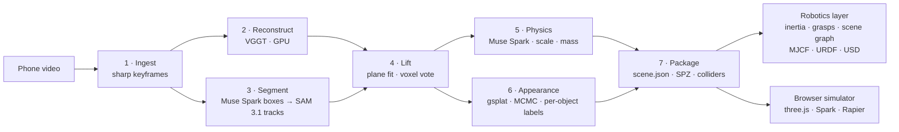
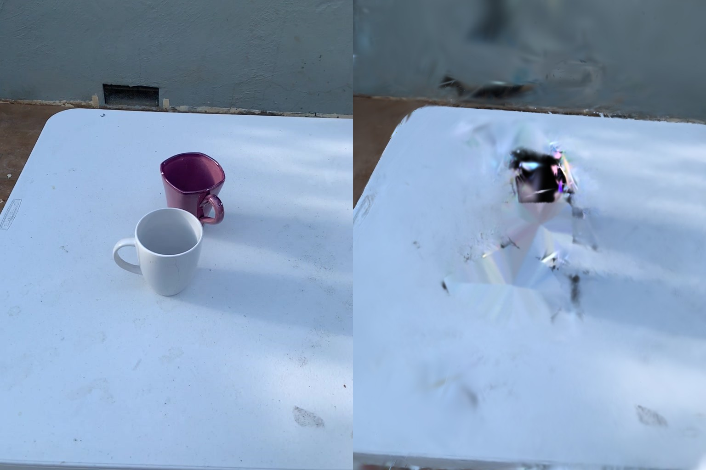
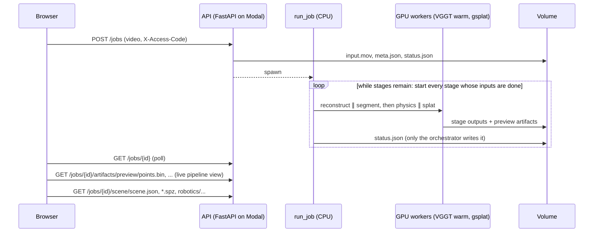

# Architecture

Darius compiles a 20–60 second phone video of a tabletop into a *simulation-ready* scene: every object
separated, named, metrically scaled, given mass, inertia, friction and restitution, annotated with grasp candidates
and a 3D scene graph, and written for a browser simulator and for robot simulators. This document explains how,
and why each design decision was made. The robotics layer has its own reference: [robotics.md](robotics.md).

## The package, in layers

The Python package ([`pipeline/darius`](../pipeline/darius)) is layered: a layer imports only from the layers above
it in this list, never below, so the contract and the robotics layer stay usable without any of the cloud machinery.

| Layer | Contents | Depends on |
|---|---|---|
| `core` | point-cloud geometry, coordinate frames, the material table, cross-process errors | NumPy, SciPy |
| `scene` | the scene package contract: Pydantic schema, asset I/O (OBJ, PLY, primitives), compact JSON | `core` |
| `models` | Meta Model API clients: Muse Spark (structured JSON), SAM 3.1 (streamed masks) | `core` |
| `robotics` | mass properties, grasp synthesis, scene graph, MJCF / URDF / USD writers, MuJoCo environment | `core`, `scene` |
| `pipeline` | the seven stages, the stage graph, previews, packaging | all of the above |
| `calibration` | friction measured from a filmed push, written back into the scene | `models` |
| `service` | the FastAPI service and "what if" planning | `pipeline`, `models` |
| `eval`, `tools` | Objectron ground truth; gallery rebuild and validation | — |

Importing `darius` is cheap (subpackages load on first use), because each cloud image installs only what its own
stages need: the VGGT image has no Pydantic, the splat image no OpenCV.

## Design principles

1. **One contract.** The compiler and every consumer share nothing but the
   [scene package format](scene-format.md). The simulator was built and tested against a hand-written
   scene before the pipeline existed, and that scene still runs in CI.
2. **Every stage is a pure function of a folder.** A stage reads earlier outputs from the job folder
   and writes its own, ending with a marker file ([`jobs.py`](../pipeline/darius/pipeline/jobs.py)). A failed or
   changed stage re-runs alone (`--start physics`) without paying for the GPU stage again, and stages whose
   inputs are ready run at the same time.
3. **Models propose, geometry decides.** Foundation models are used where they are strong (recognition,
   segmentation, priors about the world); everything that can be *measured* from the reconstruction is
   measured. Mass is computed from volume, not guessed; model outputs are schema-constrained, then
   range-checked.
4. **Measure everything that can be measured.** The pipeline is evaluated against metric ground truth
   ([results](results.md)), and the physics engines against closed-form mechanics (tests).
5. **Derived data is computed once.** Mass properties and grasps are written into scene.json; every exporter works
   from one robotics model built from it, so MJCF, URDF, USD and the browser cannot disagree.

## Stage by stage

### 1 · Ingest ([`frames.py`](../pipeline/darius/pipeline/ingest.py))

Candidates are decoded at 12 fps, split into 48 equal time bins, and the sharpest frame (variance of
the Laplacian) wins each bin. Bins whose best frame is under 30% of the median sharpness are dropped
rather than polluting reconstruction. Too-short, too-dark and mostly-blurry videos are rejected with
an actionable message (`InputError`), which the processing screen shows verbatim.

The selected frames are re-encoded as a short H.264 clip. **Frame *i* of the clip SAM tracks is frame
*i* that VGGT reconstructs**: that one-to-one correspondence turns lifting 2D masks into 3D from a
search problem into a lookup.

### 2 · Reconstruct ([`reconstruct.py`](../pipeline/darius/pipeline/reconstruct.py))

[VGGT](https://github.com/facebookresearch/vggt) (Wang et al., CVPR 2025) predicts camera poses, depth
and confidence for all keyframes in a single feed-forward pass: no feature matching, no bundle
adjustment. On an L40S, 26–48 frames take about 2 s of inference and 8 GB peak memory. World points
come from depth + cameras, which the VGGT authors report as more accurate than the point-map head.

Details that matter:

- Frames are resized to a 518 px long side with both sides multiples of the 14 px ViT patch, **without
  cropping**. VGGT's own loader center-crops portrait images, which discards a third of a phone video's
  field of view.
- The model runs in a warm Modal class (`Reconstructor`): weight loading is ~45 s, inference ~2 s, so
  a container stays up for 5 minutes between jobs.
- Weights: `facebook/VGGT-1B-Commercial` (the original `VGGT-1B` weights are CC BY-NC).

### 3 · Segment ([`segment.py`](../pipeline/darius/pipeline/segment.py))

The sharpest frame in the middle half of the video is the keyframe. **Muse Spark** lists each movable
object on the table with a short label and a box on its 0–1000 grid (structured JSON output).
**SAM 3.1** receives those boxes as *box prompts* on the keyframe and propagates masks forward and
backward through the clip under our own object ids.

Why boxes rather than SAM's text prompts: live testing showed SAM 3.1's concept prompts are very
sensitive to wording ("mandarin orange" finds nothing where "orange" finds all six) and cannot take a
generic prompt ("object" finds nothing), while Muse Spark's labels vary between runs. Box prompts make
the handoff wording-independent. Masks are rasterized at reconstruction resolution into per-frame
label maps; where masks overlap, the more confident one wins.

### 4 · Lift ([`lift.py`](../pipeline/darius/pipeline/lift.py), [`geometry.py`](../pipeline/darius/core/geometry.py))

Each VGGT point comes from exactly one pixel of one keyframe, so it arrives already labeled. The
problem is noise, not association:

1. **Confidence filter:** drop the lowest 30% of VGGT depth confidence.
2. **Gravity.** RANSAC fits the table plane to *background points near the objects* (within 2.5× the
   objects' 90th-percentile radius), so a wall or the floor cannot win. The normal is oriented toward
   the mean camera center, because cameras filming a tabletop are above it, and the scene is rotated
   so the table is y = 0 with +y up. Diagnostics record the inlier RMS and the fraction of cameras
   above the table (should be 1.0).
3. **Multi-view voting.** Points are voxelized (0.4% of the median camera distance) and each voxel
   takes a label by majority vote over every point that fell in it, from every frame. It needs at least
   half the votes. A mask that bleeds onto the table in one view is outvoted by the views where it
   didn't.
4. **Cleanup per object:** discard points within 2× the plane threshold of the table, remove
   statistical outliers (16-NN), keep the largest 26-connected voxel component. Objects with fewer
   than 300 points stay in the background rather than becoming junk rigid bodies.

### 5 · Physics ([`physics.py`](../pipeline/darius/pipeline/physics.py))

For each object, Muse Spark sees three crops from well-separated frames with everything outside the
mask dimmed, and returns (JSON-schema constrained): category, material, **typical dimensions**,
typical mass, hollowness, fill fraction, friction, restitution, fragility, and confidence.

**Metric scale.** VGGT reconstructs up to an unknown scale. Each confidently recognized object votes
for one: `scale = median(sorted expected dims / sorted measured dims)`. Matching by rank sidesteps
"which side is the length", and the median of three ignores one badly measured side. The scene scale
is the confidence-weighted median of the votes, so one misrecognized object can't capture it. On the
two-mug scene the two independent votes agree to within 2.5%; across 24 Objectron clips the median
size error is 1% (see [results](results.md)).

**Mass** is computed, not guessed: `convex-hull volume × material density × fill fraction`, with
density from the shared [material table](../pipeline/darius/data/materials.json). The model's direct
mass guess is only a sanity check: if they disagree by more than 2.5×, the typical mass wins and
`physics_notes` says why.

**Supporting base.** Cameras circling above a table barely see an object's lower edge, and
reconstructions are sparse and one-sided there. Projecting only the lowest ring of points made a
scanned mug's base coin-sized, and it tipped over in MuJoCo. The collider now gets the footprint of
the object's lower half projected onto the table, which is the physically sensible support prior
(`geometry.complete_bottom`).

### 6 · Appearance ([`splats.py`](../pipeline/darius/pipeline/splats.py))

Appearance comes from 3D Gaussian splatting with [gsplat](https://github.com/nerfstudio-project/gsplat),
optimized jointly over the whole scene at full keyframe resolution (6,000 iterations, L1 + SSIM, SH
degree 1, about two minutes on an L40S).

- **MCMC densification, anti-aliased rasterization.** Densification uses MCMC (Kheradmand et al., 2024): a fixed
  budget of 450,000 Gaussians that are relocated rather than cloned and pruned, with no opacity resets. A budget
  matters twice: training time, and the browser, which pays for every splat on every frame. Rasterization is
  anti-aliased (gsplat's Mip-Splatting-style 2D filter), so splats stay correct at the resolutions the viewer
  renders at. Retraining the demo scenes this way raised held-out PSNR on every clip, by 0.4 to 3.8 dB
  (median +2.2 dB; [results](results.md#appearance-mcmc-densification)).
- **An initialization budget.** Gaussians start from the lifted points: at most 300,000, of which objects get up to
  half in proportion to their size and the background the rest. A close-up clip can lift a million points on one
  object; keeping them all once left no budget for the background, so the table had no Gaussians of its own.

- **Separation by construction.** Gaussians are initialized from the lifted, labeled points, and each
  carries its point's label (0 = background, *k* = object *k*) as a non-trainable parameter. gsplat's
  densification clones, splits and prunes every parameter by index, so labels follow their Gaussians
  through training. Objects and background are optimized together, so lighting and occlusion between
  them stay consistent, and afterwards each object's splats lift out cleanly.
- **Camera refinement.** VGGT's cameras come from a 518 px pass, and at 1024 px their small errors
  show up as doubled edges. Each camera gets a learnable rigid correction (Rodrigues rotation plus
  translation), and all share one focal-length scale. gsplat provides no gradient for intrinsics, so the
  focal scale is learned as what it is geometrically: a zoom of the rendered image about the principal
  point, which `grid_sample` makes differentiable. On the two-mug scene, pose refinement took held-out
  PSNR from 27.5 to 28.9 dB and the focal scale (+0.7%) to 29.4 dB.
- **What didn't help.** A per-frame affine color correction for auto-exposure changed held-out PSNR by
  −0.4 to +0.15 dB, so it was removed. Training 15,000 instead of 6,000 iterations was worse (28.5 dB)
  and nine times slower: with about 20 training views, longer schedules overfit.
- **Honest evaluation.** Every eighth keyframe is held out. Its camera is never trained, so before
  scoring, its own correction is fit with the splats frozen (test-time pose alignment).
- **Clean-up at packaging**, so nothing is left behind when an object moves. These rules were
  developed by rendering the scene with every object removed and fixing what showed up
  (`modal_app.background_preview`):
  - object splats outside their object's box, needle-shaped ones, and ones over 1 cm (or 8% of the object's
    size) are dropped. MCMC draws with fewer, larger Gaussians than clone-and-split: at the earlier 5 mm limit, 16%
    of a scanned mug was dropped and it rendered see-through;
  - background splats whose extent overlaps an object's box (grown 1.5 cm) are dropped, along with
    those just below the table inside a footprint, which the optimizer parks there to help draw the
    object from above;
  - the table under each object was never seen and got painted with the object's colors, so each
    footprint (+1.5 cm) is cleared at table level and re-covered with flat, opaque splats whose colors
    are interpolated from the visible table around it.

  

  A rule that dropped "floaters" far from reconstructed background points was tried and reverted: the
  reference points had already been height-filtered, so it deleted the wall.
- **Format.** Splats are written as [SPZ](https://github.com/nianticlabs/spz) v3 with Niantic's reference
  library (about 10× smaller than PLY), each object in its own local frame, round-trip tested in CI.

### 7 · Package ([`package.py`](../pipeline/darius/pipeline/package.py))

**Colliders.** A single convex hull fills every concavity. [CoACD](https://github.com/SarahWeiii/CoACD)
(approximate convex decomposition) runs on a watertight voxel surface of each object, but parts are kept
only if they remove at least 15% of the hull's volume, measured by Monte Carlo. Otherwise the single
hull is cheaper and just as accurate. In practice this matters for handles and L-shapes, not cavities:
VGGT's depth noise fills a mug's interior, so no decomposition can recover a hollow the scan doesn't
contain. The single hull is always kept as `pick_hull` for raycasts.

**Table.** The visible table top becomes a convex polygon (`table_plane.polygon_m`): table-plane points
are binned on a 2 cm grid, and the largest dense region is outlined, so stray coplanar points can't
stretch it. The outline is then grown to cover every object's footprint (plus 3 cm): the support surface must reach
under everything resting on it, and on a kitchen counter filmed at a grazing angle the dense region covered only
42 × 28 cm, so three of five objects fell off it in simulation. Its bounding box is the `size_m` fallback.

**Backdrop.** Background splats over the table outline (up to 1.5× the tallest object) are the table layer; the rest
(walls, floor, the room) go to `backdrop.spz`, which viewers fade out away from the filmed path, where it was never
trained.

**Robotics.** Finally the robotics layer annotates every object with its mass distribution and grasp candidates,
and writes the robotics bundle (MJCF, URDF, USD, `world.json`, the scene graph) and `export.zip`
([robotics.md](robotics.md)). A `pipeline/` folder with the stage outputs (keyframe sheet, labeled point cloud,
masks, held-out render, per-stage diagnostics) lets the web app replay how the scene was built.

Everything is converted to meters once. Each object's points and hull are written in object-local
coordinates (origin at the bounding-box center) so a simulator can attach them to a rigid body
directly. Hulls are capped at 32 vertices by farthest-point sampling: at 96, a scanned mug's many tiny
near-coplanar faces kept it rocking forever in Rapier; at 32 it settles and sleeps within 3 s.
The clean keyframe becomes the gallery thumbnail.

## Runtime

- **Concurrency:** the orchestrator (`run_job`) runs the stage graph with a thread pool of remote calls: each
  stage starts as soon as the stages it reads from are done, so reconstruction (GPU) overlaps segmentation (API
  calls), and physical estimation overlaps splat training. Physics calls Muse Spark once per object, in parallel.

- **Compute:** stages are separate Modal functions with their own images: VGGT pins torch 2.3.1 and
  numpy < 2, so it is isolated from the CPU image. Every function has a timeout. The GPU request is a
  fallback list (`L40S → A100-40GB → L4`).
- **State:** a Modal Volume holds job folders; weights are cached in a second volume.
- **Errors:** third-party exceptions don't survive pickling between containers, so stages re-raise
  them as plain `RuntimeError` messages, and the processing screen shows which stage failed and why.
- **Cost controls:** endpoints that spend GPU time or API credits (`POST /jobs`, `POST /what-if`) can
  require a shared access code (`DARIUS_ACCESS_CODE`); read-only endpoints are open and cacheable.
- **Live artifacts:** `GET /jobs/{id}/artifacts/{name}` serves each stage's output from an allow-list (traversal
  attempts are tested), so the processing screen draws the keyframes, the point cloud and the masks as they appear.

## Simulator

The browser simulator (`frontend/`) loads a scene package and runs Rapier (WASM) at a fixed 120 Hz,
decoupled from rendering. Object-vs-table contacts use exactly the manifest's coefficients (table
coefficients 0, `Max` combine rule), which is what makes estimated and measured friction meaningful
in simulation.

- **Rendering.** Spark renders the splats straight to the canvas. An earlier post-processing chain rendered into a
  multisampled half-float target: Spark then blended in linear light (the splats were trained in sRGB, so they
  looked washed out) and the target cost most of the frame. A CSS vignette replaces the grade pass.
- **On demand.** A frame is drawn only when something changed: a body that is awake, the camera (OrbitControls
  `change`), a finished splat sort (Spark's `onDirty`), a view or selection change. A resting scene costs nothing.
- **Adaptive resolution.** The pixel ratio starts at 1.5× at most and steps down by 0.25 after eight slow frames
  (over 22 ms), and back up after 240 fast ones; splat rendering is fill-rate bound, so this is the lever that works.
- **Real time.** Up to 24 physics steps per frame keep the simulation in real time down to 5 fps. At the earlier
  cap of 8, an 8 fps frame rate ran physics at half speed, which read as weak gravity.
- **Holding.** The grabbed point follows the pointer on a spring that Rapier solves implicitly, with stiffness
  m ω² (ω = 31 rad/s) and critical damping: every object sags the same g / ω² ≈ 1 cm, where a fixed 400 N/m spring let
  a 23 kg toaster hang half a meter below the pointer. Carried objects keep their rotation locked (Q / E turn them);
  releasing throws at the hand's velocity over the last 80 ms; a ring marks where a carried object will land.
- **Table collider.** The outline is a closed triangle-mesh slab with Rapier's internal-edge fix, so objects slide
  across the fan's seams as on a flat table, at Rapier's default 1 m length unit: at 0.1 the internal-edge fix let
  a 3 cm scanned book fall straight through the slab.
- **Views.** Scene, Colliders, Physics, and Robot: the exported model's centers of mass, equivalent inertia
  ellipsoids (semi-axes √(5/2m (I₂ + I₃ − I₁)), …) and grasp candidates, over the +z-up robot frame.

**"What if"** turns plain English into simulation actions with Muse Spark *tool calling*
([`whatif.py`](../pipeline/darius/service/whatif.py)): the model sees a compact scene description and returns
calls such as `apply_impulse(obj_02, [1,0,0], 1.5)` or `bump_table([0,0,-1], "hard")`. It never touches
the simulation; the browser validates every argument (model output is untrusted input) and executes
the calls.

## Reality check

Real-to-sim needs a way to *measure* physics, not only estimate it. Film a flick of one object from a
fixed phone; SAM 3.1 tracks it; pixels are converted to meters with the object's known footprint.
After release, Coulomb friction gives constant deceleration, so the path distance obeys

$$s(t) = s_0 + v_0 t - \tfrac{1}{2}\,\mu g\, t^2$$

which is linear in $(s_0, v_0, \mu)$ and solved by least squares on the sliding segment
([`reality_check.py`](../pipeline/darius/calibration/reality_check.py)). Re-simulating the same push with the
estimated and the measured μ gives the slide-distance error before and after correction, and the
measured value is written back into the scene with `physics_source: "measured"`. The estimator is
validated on synthetic tracks with noise (it recovers μ within 12% and closes the distance error to
within 8%). See [limitations](../README.md#limitations) for what has not been validated on real
footage yet.
