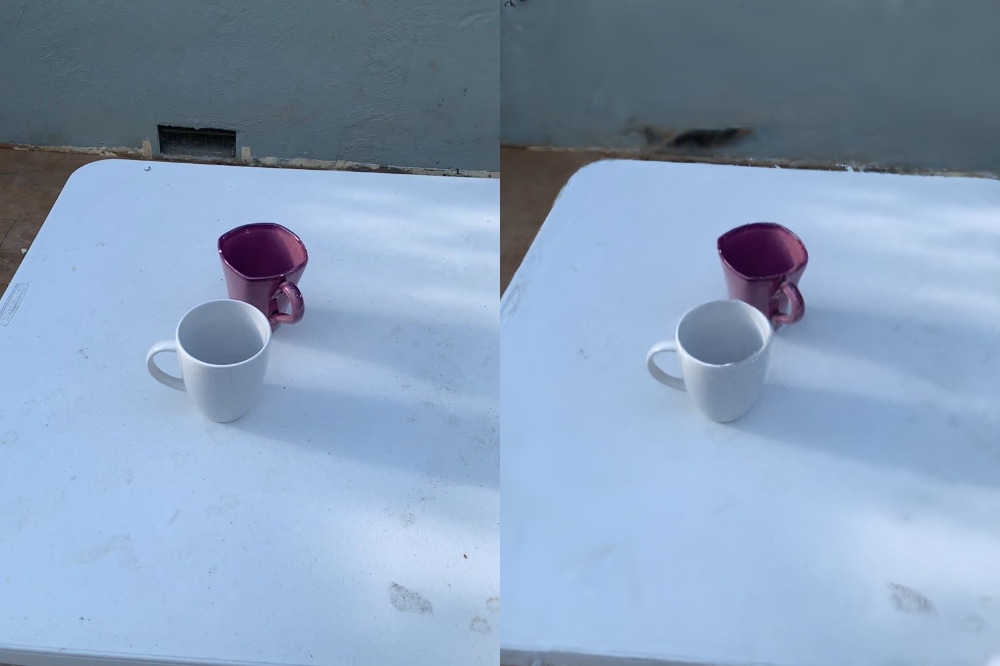

# Results

Generated by `pipeline/scripts/report.py` from [`results/objectron.json`](results/objectron.json).

## Benchmark: Objectron

[Objectron](https://github.com/google-research-datasets/Objectron) (Ahmadyan et al., CVPR 2021) is a set of
short phone videos, each annotated with ARKit-measured **metric** 3D boxes. That makes it a direct test of
the hardest part of the pipeline: the scan is reconstructed without scale, so getting an object's real
size right means detection, tracking, 3D separation, recognition and scale estimation all worked.
We take the first
4 test-split clips of each tabletop-sized class
(book, bottle, camera, cereal box, cup, shoe): 24 clips in total,
processed end to end with no per-clip tuning.

Ground-truth objects are matched to detections by their projected box centers on the keyframe
(within 12% of the frame), so a two-object scene can't be scored optimistically.

| Metric | Result |
|---|---|
| Clips processed end to end | 24 / 24 |
| Ground-truth objects detected | 24 / 25 |
| … separated into a 3D rigid body | 24 / 25 |
| Label correct (class word in label) | 100% |
| Size within ±25% of truth | 88% |
| Median size ratio (estimated / true) | 0.99× |
| Median relative error, all three dimensions | 18% |
| Median processing time per clip (sum of stages) | 377 s |

## Appearance: Gaussian splats

Each scene is optimized as 3D Gaussian splats (gsplat, 6,000 iterations, SH degree 1) from VGGT's
cameras, which are refined jointly with the splats. Every eighth keyframe is held out of training.
Because a held-out view's camera is never trained, its pose correction is fitted with the splats frozen
before scoring (test-time pose alignment, standard for pose-optimizing radiance fields).

| Metric | Result |
|---|---|
| Scenes | 24 |
| Held-out PSNR, median (min–max) | 23.2 dB (18.2–29.9) |
| Training-view PSNR, median | 23.1 dB |
| Training time, median | 90 s |
| Mean camera rotation correction, median | 0.7° |
| Objects given a convex-part collider | 24 / 45 |

On the two-mug scene, refining VGGT's cameras raised held-out PSNR from 27.5 to 28.9 dB and removed
doubled edges; a learned focal scale added 0.5 dB more. Two things that did not help: per-frame color
correction for auto-exposure (−0.4 to +0.15 dB, removed), and 15,000 instead of 6,000 iterations
(28.5 dB, nine times slower; with about 20 training views, longer schedules overfit).

Training-view PSNR is close to held-out PSNR on every clip, so the weaker scenes are limited by fitting,
not overfitting. They are cluttered stores and shelves, where VGGT's geometry is noisiest.

## Appearance: MCMC densification

The ten demo scenes were retrained with MCMC densification (Kheradmand et al., 2024): a fixed budget of
450,000 Gaussians relocated rather than cloned and pruned, with anti-aliased rasterization, otherwise the
same 6,000 iterations, cameras and held-out frames. Held-out PSNR improved on every clip.

| Scene | Objectron clip | Clone-and-split | MCMC | Change |
|---|---|---|---|---|
| Book standing on a desk | `book/batch-12/11` | 23.1 dB | 26.9 dB | +3.8 dB |
| Cereal box on tiles | `cereal_box/batch-21/27` | 22.9 dB | 26.5 dB | +3.6 dB |
| Coffee mug | `cup/batch-5/39` | 27.9 dB | 31.4 dB | +3.5 dB |
| Paperback on a quilt | `book/batch-6/16` | 27.4 dB | 29.7 dB | +2.3 dB |
| Leather dress shoe | `shoe/batch-9/25` | 29.9 dB | 32.1 dB | +2.2 dB |
| DSLR camera | `camera/batch-12/32` | 26.2 dB | 28.0 dB | +1.8 dB |
| Red party cup | `cup/batch-37/28` | 29.8 dB | 31.4 dB | +1.6 dB |
| Book on a patterned cloth | `book/batch-20/35` | 24.3 dB | 25.2 dB | +1.0 dB |
| Kitchen counter | `bottle/batch-3/14` | 27.3 dB | 27.7 dB | +0.4 dB |
| **Median** | | **27.3 dB** | **28.0 dB** | **+2.2 dB** |

## Ablation: telling the model the scan's proportions

The physics stage asks Muse Spark for an object's *typical* real-world size, and the ratio to the
measured (unscaled) size votes for the scene scale. An obvious improvement is to also tell the model
the scan's measured proportions. Both prompts were run on the same reconstructions. The result is
mixed: the hint tightens the typical error but produces more large misses, so the default prompt
omits it (fewer objects off by more than 25% matters more for a usable simulation).

| Prompt | Size within ±25% | Median size ratio | Median abs. log2 error | Median dims error |
|---|---|---|---|---|
| Typical size, no hint (default) | 88% | 0.99× | 0.18 | 18% |
| Typical size, given scan proportions | 92% | 0.95× | 0.17 | 16% |

## Failures

Clips that hit a transient Meta Model API error (intermittent `404 model not found`, dropped
connections; see [api-notes](api-notes.md)) are resumed from the stage that failed, which reuses every
earlier stage's output. In the run reported here, two of 24 clips needed that second pass. The table
lists clips that still failed afterward.

| Clip | Stage | Error |
|---|---|---|
| – | – | none |

## Per-object results (default prompt)

| Clip | Label | True extents (cm) | Estimated (cm) | Size ratio | Mass |
|---|---|---|---|---|---|
| `cup/batch-16/47` | metal cup | 7.0 × 11.0 × 7.0 | 9.0 × 9.9 × 9.4 | 1.16 | 150 g |
| `cup/batch-37/28` | plastic cup | 9.9 × 11.4 × 8.9 | 11.7 × 8.9 × 12.0 | 1.07 | 34 g |
| `cup/batch-5/39` | coffee mug | 13.0 × 10.0 × 9.0 | 12.0 × 8.0 × 10.2 | 0.94 | 355 g |
| `cup/batch-10/31` | plastic mug | 11.0 × 10.0 × 8.0 | 13.7 × 8.0 × 9.0 | 1.04 | 84 g |
| `book/batch-20/35` | book | 24.0 × 2.0 × 15.0 | 15.5 × 2.9 × 14.0 | 0.96 | 312 g |
| `book/batch-6/16` | paperback book | 18.0 × 4.0 × 12.0 | 12.0 × 3.0 × 10.5 | 0.76 | 139 g |
| `book/batch-31/44` | book | 25.0 × 6.0 × 17.7 | 32.3 × 5.9 × 22.0 | 1.16 | 2626 g |
| `book/batch-12/11` | book | 23.0 × 5.0 × 21.0 | 20.8 × 18.0 × 10.5 | 1.18 | 1935 g |
| `bottle/batch-3/14` | liquor bottle | 8.0 × 26.0 × 8.0 | 9.7 × 23.4 × 5.0 | 0.88 | 1343 g |
| `bottle/batch-40/29` | wine bottle | 8.0 × 29.5 × 8.0 | 8.0 × 23.2 × 8.4 | 0.94 | 1976 g |
| `bottle/batch-28/4` | syrup bottle | 6.0 × 24.0 × 5.0 | 23.0 × 6.0 × 8.4 | 1.17 | 500 g |
| `camera/batch-7/24` | digital camera | 12.0 × 6.0 × 4.0 | 12.6 × 5.2 × 4.1 | 0.98 | 338 g |
| `camera/batch-3/11` | digital camera | 11.0 × 7.0 × 3.0 | 18.3 × 7.5 × 9.7 | 1.79 | 210 g |
| `camera/batch-7/44` | camera | 12.0 × 7.0 × 10.0 | 10.8 × 5.5 × 10.5 | 0.91 | 692 g |
| `camera/batch-12/32` | dslr camera | 13.0 × 11.1 × 7.3 | 18.2 × 7.2 × 11.0 | 1.11 | 561 g |
| `cereal_box/batch-26/22` | cereal box | 15.0 × 21.0 × 5.0 | 33.4 × 3.2 × 14.0 | 0.98 | 608 g |
| `cereal_box/batch-26/12` | cereal box | 14.0 × 20.0 × 5.0 | 77.8 × 2.6 × 16.0 | 1.32 | 440 g |
| `cereal_box/batch-24/3` | cereal box | 20.0 × 27.0 × 5.0 | 28.0 × 5.5 × 27.2 | 1.16 | 350 g |
| `cereal_box/batch-21/27` | cereal box | 15.0 × 20.0 × 5.0 | 18.6 × 4.3 × 19.0 | 1.00 | 425 g |
| `shoe/batch-14/30` | sneaker | 12.0 × 13.0 × 29.0 | 22.2 × 10.5 × 13.5 | 0.89 | 192 g |
| `shoe/batch-14/30` | sneaker | 12.0 × 13.0 × 29.0 | 21.6 × 8.9 × 10.3 | 0.76 | 122 g |
| `shoe/batch-2/13` | high heel shoe | 12.0 × 14.0 × 27.0 | 19.1 × 8.0 × 10.3 | 0.70 | 217 g |
| `shoe/batch-30/39` | sneaker | 10.0 × 12.0 × 28.0 | 28.0 × 7.9 × 13.4 | 0.96 | 192 g |
| `shoe/batch-9/25` | dress shoe | 11.0 × 8.0 × 27.0 | 26.0 × 10.0 × 13.9 | 1.15 | 512 g |

True extents are Objectron's box in the object's own canonical frame; estimates are gravity-aligned
(length, height, width). An object lying on its side therefore lists the same extents in a different
order, which is why sizes are compared as sorted extents. The size ratio is their geometric mean.

## Physics engine checks

These run in CI on every commit:

- **Coulomb sliding:** a pushed box in the browser simulator (Rapier, 120 Hz) slides the closed-form
  `v0² / (2 μ g)` (asserted within 8%), so estimated and measured friction mean what they say.
- **Restitution:** a dropped rubber ball (e = 0.85) rebounds close to `e² × h`, while a low-restitution
  box barely lifts.
- **Stability:** every shipped scene settles with no sinking, jitter or drift, both in the browser and
  after export, in MuJoCo (`darius sim`: under 3 cm of drift and 3 mm of motion in the final half second).
- **Exported restitution:** in the MJCF, a rubber ball dropped from 21.5 cm rebounds to e² of that height
  within 15%, which holds only because the contact's time constant is derived from a fixed natural period.
- **Robotics round trips:** every exported scene loads in MuJoCo with the manifest's masses, centers of mass
  and principal moments; every URDF compiles; the USD stage opens with `pxr` with Z up, rigid bodies and
  bound physics materials ([robotics](robotics.md#verification)).
- **Friction estimator:** on noisy synthetic push tracks, the reality-check fit recovers μ within 12%
  and re-simulation closes the slide-distance error to within 8%.
