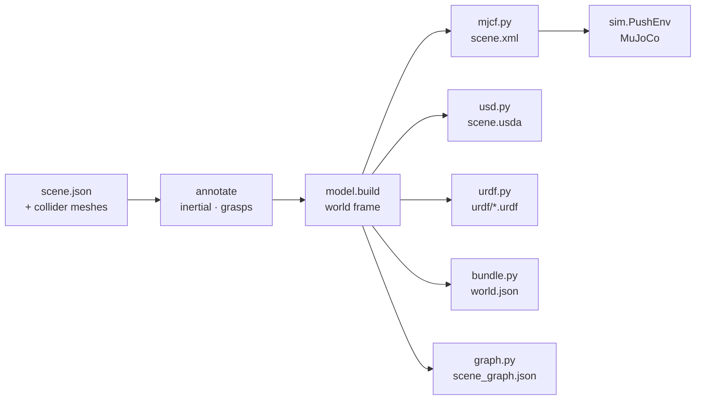

# Robotics

Darius compiles every scene into a robot environment: the same objects, at the same poses, with the same physical
parameters, written for MuJoCo, Isaac Sim (OpenUSD + UsdPhysics) and URDF consumers, plus a JSON manifest and a 3D
scene graph for planners. This document specifies what is written, how every number is computed, and how each
output is checked.

Code: [`pipeline/darius/robotics`](../pipeline/darius/robotics). Everything in it reads scene packages only, never
pipeline internals, so it works on any scene: scanned, hand-authored, or edited.



`annotate` writes each object's `inertial` and `grasps` back into scene.json, so the browser, the exporters and any
other consumer see the same values. `model.build` then converts the scene once into the robotics conventions, and
every writer works from that one model: they cannot disagree about a pose, a mass or a grasp.

## Frames

All frames are right-handed and in meters ([`core/frames.py`](../pipeline/darius/core/frames.py)).

| Frame | Used by | Convention |
|---|---|---|
| **scene** | scene.json, splats, points, hull OBJs, the browser | +y up, table top is y = 0, +z toward the filming side (glTF / three.js) |
| **world** | every robotics output, `darius.robotics` | +z up ([REP 103](https://www.ros.org/reps/rep-0103.html)), table top is z = 0 |
| **body** | each object | origin at the capture-time bounding-box center; scene axes in scene.json, world axes in exports |
| **camera** | `world.json` | OpenCV: x right, y down, looking along +z |
| **camera** | scene.json `capture`, MJCF `<camera>`, USD `Camera` | OpenGL: x right, y up, looking along −z |
| **grasp** | scene.json, MJCF sites, `world.json` | origin midway between the fingertips, +z approach, +y closing axis |

The world frame is the scene frame turned +90° about x: the scene point (x, y, z) is the world point (x, −z, y).
Positions map by that rotation W; a body orientation q maps by conjugation, W q W⁻¹, because the body's own axes
change convention too. Quaternions are `[x, y, z, w]` everywhere in JSON and `[w, x, y, z]` in MJCF and USD text.

## The bundle

```
<scene>/robotics/
├── README.md          generated: objects, conventions, loading snippets for each simulator
├── scene.xml          MuJoCo MJCF
├── scene.usda         OpenUSD with UsdPhysics
├── urdf/<id>.urdf     one per object, plus table.urdf
├── world.json         format darius.robotics/1
├── scene_graph.json   format darius.scene_graph/1
└── meshes/*.obj       collision parts, hull visuals and the table slab, in body frames, +z up
<scene>/export.zip     scene.json + robotics/, with fixed timestamps (byte-reproducible)
```

`darius export SCENE` writes it; the pipeline's package stage writes it for every new scan; `darius gallery`
rebuilds it for every shipped scene, and CI fails if anything committed is out of date (numbers compared to a
relative 1e-4, because floating-point results can differ in the last digit across machines).

## Mass properties

[`mass.py`](../pipeline/darius/robotics/mass.py). The pipeline estimates each object's mass m (hull volume ×
material density × fill fraction). A simulator also needs the center of mass c and the inertia tensor I about it.

**Volume integrals.** Every face (a, b, c) of a closed, outward-wound mesh spans a signed tetrahedron with the
origin, whose moments have closed forms:

- volume V = a · (b × c) / 6
- first moment ∫x dV = V (a + b + c) / 4
- second moment ∫x xᵀ dV = V/20 (a aᵀ + b bᵀ + c cᵀ + s sᵀ), s = a + b + c

Summed over all faces (and over every convex part), the contributions outside the solid cancel exactly. With
uniform density, c = ∫x dV / V, the covariance about c is C = ∫x xᵀ dV / V − c cᵀ, and
I = m (tr(C) 𝟙 − C).

**Hollow objects.** A mug, a shoe or a box carries its mass in a wall, not in the volume its hull encloses; a solid
model makes it too easy to spin. The wall is modeled as the hull minus a copy of itself scaled by s about the
centroid, with s chosen so the wall holds the object's fill fraction f of the hull's volume: 1 − s³ = f. Both
solids have the same shape, and a solid's inertia per unit mass scales with the square of its size, so

  I_wall / m = (I_hull / m_hull) · k,  k = (1 − s⁵) / (1 − s³)

k runs from 1 (f = 1, solid) to 5/3 (f → 0, a thin shell): a solid sphere's 2/5 m r² becomes the thin spherical
shell's 2/3 m r². The center of mass is unchanged. scene.json records which model was used (`"model": "shell"`).

**Principal axes** (for USD's `diagonalInertia` and `principalAxes`) are canonicalized so exports reproduce on any
machine: a tensor that is already diagonal keeps the body axes (symmetric shapes have no unique principal axes),
otherwise each axis points along its largest component's positive direction.

Tests ([`tests/test_mass.py`](../pipeline/tests/test_mass.py)): boxes, cylinders and spheres against their closed
forms; the thin-shell limit; parallel-axis invariance; two touching parts equal one box; canonical axes.

## Grasp candidates

[`grasps.py`](../pipeline/darius/robotics/grasps.py). A parallel-jaw grasp holds by friction when each contact's
surface normal lies inside the friction cone around the closing axis, at most atan μ from it: an antipodal grasp
(Nguyen, 1988). Candidates are synthesized on each object's convex hull in its body frame:

1. Sample 1,500 contact points p on the hull, area-weighted, with outward normals n.
2. Close along −n. On a convex hull the ray leaves through the first face plane it is heading out of: the opposite
   contact q, found for all samples at once as a (samples × faces) ray–plane problem.
3. Keep the pair if the width |q − p| fits the gripper, q's normal is inside the friction cone, and both fingertips
   clear the table (the object's lowest point) by 8 mm, plus half a finger's width for side approaches.
4. Approach perpendicular to the closing axis and as close to straight down as it allows.
5. Score in [0, 1]: √(friction-cone margin) × exp(−(d / 0.25 L)²) × (0.6 + 0.4 · top-down) × width headroom, where d
   is how far the closing line passes from the center of mass (gravity's torque about the fingertips is resisted
   only by torsional friction) and L the object's size. Then suppress near-duplicates (centers within 1 cm with
   parallel axes) and keep the best eight.

The default gripper opens to 140 mm, like a Robotiq 2F-140: tabletop objects such as mugs, shoes and cameras are 9
to 14 cm across, beyond a Franka Hand's 80 mm (`Gripper(max_width_m=0.08)`). Candidates are proposals for a planner,
not verified grasps: the hull fills concavities (a mug's handle loop), so a candidate can reach into space the real
object occupies.

Tests ([`tests/test_grasps.py`](../pipeline/tests/test_grasps.py)): a narrow box is grasped across its thinnest side
from above; objects wider than the gripper get none; a book lying flat is never pinched through the table; a
ball is grasped across its diameter; frames are orthonormal and survive scene.json; low friction narrows the cone.

## MuJoCo (MJCF)

[`export/mjcf.py`](../pipeline/darius/robotics/export/mjcf.py).

- Objects are bodies with a free joint and an explicit `<inertial>` (mass, center of mass, `fullinertia`), one
  geom per convex part, and grasp candidates as `<site>`s named `<object>/grasp_<k>` (best first).
- The table is a static convex mesh: the scanned outline, 4 cm thick, top at z = 0. A floor plane sits
  `floor_depth_m` below.
- `<camera>`s at the opening view and up to seven capture viewpoints; a `capture` keyframe with every object's
  initial pose.
- `implicitfast` integration at 2 ms.

**Contact parameters.** scene.json's friction and restitution describe each object *against the table*. Object
geoms have `priority` 1 and the table 0, so a table contact uses exactly the object's parameters; between two
objects MuJoCo takes the larger friction, as the browser does.

MuJoCo has no restitution coefficient; a contact is a damped spring set by `solref` = (time constant τ, damping
ratio ζ). For an underdamped oscillator the coefficient of restitution is e = exp(−ζπ / √(1 − ζ²)), so

  ζ = −ln e / √(π² + ln² e).

The time constant needs care. MuJoCo's contact stiffness scales as 1 / (τ ζ)², so a bouncy object (rubber, e = 0.85,
ζ ≈ 0.05) with the customary τ = 0.01 s gets a contact oscillating faster than the 2 ms step can resolve: the
solver injects energy, and a ball dropped from 25 cm left the table at 24 m/s. Darius instead fixes the contact's
natural period to eight timesteps, ω = 2π / (8 Δt), and sets τ = max(2 Δt, 1 / (ω ζ)). In the exported sandbox a
rubber ball dropped from 21.5 cm rebounds to e² of that height, within 15%
([`tests/test_export.py`](../pipeline/tests/test_export.py)).

## OpenUSD (Isaac Sim, Isaac Lab, Omniverse)

[`export/usd.py`](../pipeline/darius/robotics/export/usd.py) writes USDA text directly (no USD library needed to
export; the tests read it back with `pxr`). Stage metadata: `upAxis = "Z"`, `metersPerUnit = 1`,
`kilogramsPerUnit = 1`.

```
/World
    PhysicsScene                 gravityDirection, gravityMagnitude
    PhysicsMaterials/<id>        PhysicsMaterialAPI: static and dynamic friction, restitution
    Table                        static mesh collider (convexHull approximation)
    Floor                        static box
    Objects/<id>                 PhysicsRigidBodyAPI + PhysicsMassAPI: mass, centerOfMass,
                                 diagonalInertia, principalAxes
        collision[_k]            PhysicsCollisionAPI + PhysicsMeshCollisionAPI (convexHull),
                                 material:binding:physics
    Cameras/<name>               UsdGeomCamera
```

PhysX averages two materials' friction by default. Each material also sets `physxMaterial:frictionCombineMode`
and `restitutionCombineMode` to `"max"` with the table at zero, so a table contact uses the object's coefficient;
consumers other than PhysX ignore those attributes.

## URDF (PyBullet, Drake, Genesis, ROS)

[`export/urdf.py`](../pipeline/darius/robotics/export/urdf.py). A URDF describes one kinematic tree, so a scene of
free objects is a set of files: load each object at its pose from `world.json` with a floating base, and the table
with a fixed base. Each link has its full `<inertial>`, collision geometry per convex part (or the primitive), a
colored hull visual, PyBullet's `<contact>` extension (lateral friction, restitution), and a `<mujoco>` block so
MuJoCo can compile the file directly.

## world.json

Format `darius.robotics/1`: every object's URDF path, pose, size, mass, center of mass, inertia
`[ixx, iyy, izz, ixy, ixz, iyz]`, friction, restitution and grasps (in the body frame, and composed into the world
frame for the captured state), plus each camera's pose (OpenCV axes), image size and intrinsics K.

## 3D scene graph

[`graph.py`](../pipeline/darius/robotics/graph.py), format `darius.scene_graph/1`. 3D scene graphs are how planners
and language-driven agents reason about a place (Armeni et al., 2019; Hughes et al., Hydra, 2022; Gu et al.,
ConceptGraphs, 2023).

| Node | Where | Attributes |
|---|---|---|
| `frame` | origin | — |
| `surface` | table centroid | area |
| `object` | center of mass | label, material, mass, size, friction, restitution, pose, hull mesh |
| `part` | convex part centroid | mesh |
| `grasp` | fingertip midpoint | opening, score, approach and closing axes |
| `camera` | capture viewpoint | — |

| Edge | Meaning |
|---|---|
| `supports` | the upper object's base is within 2.5 cm of the support's top (or the table) and their footprints overlap |
| `near` | the gap between two collision hulls is under 10 cm; `distance_m` is 0 when they interpenetrate, else the closest pair of hull vertices (an upper bound) |
| `part_of`, `grasp_of` | structure |
| `observes` | the object's center projects into the camera's image |

`darius graph SCENE` prints the relations; the web app draws the graph in 3D.

## MuJoCo environment

[`sim.py`](../pipeline/darius/robotics/sim.py): `PushEnv(scene, target=None)`, a Gymnasium-style environment
(`reset(seed)`, `step(action)` returning `(obs, reward, terminated, truncated, info)`) for planar pushing, the
classic real-to-sim benchmark. A capsule fingertip, driven kinematically at a fixed height, must push the target
object to a goal on the table; every other object is the scanned scene, with its estimated physics.

| | |
|---|---|
| Observation | `pusher` (2), `target` pose (7), `velocity` (6), `goal` (2), `objects` (N × 7) |
| Action | fingertip velocity in the table plane, clipped to 0.25 m/s, at 20 Hz |
| Reward | minus the target's distance to the goal (m) |
| Termination | within 2 cm of the goal; truncation after 200 steps |

The environment rebuilds the MJCF from scene.json when it starts, so it never runs a stale bundle. `settle()`
checks that a scene comes to rest, judged by motion over the last half second rather than by velocity: a resting
convex body can chatter between contact points with a velocity that flips sign every step while going nowhere.

## Verification

| Check | Where |
|---|---|
| Every shipped scene loads in MuJoCo with the manifest's masses, centers of mass and principal moments | `tests/test_export.py` |
| Every shipped scene comes to rest in MuJoCo (drift < 3 cm, < 3 mm of motion in the last 0.5 s) | `tests/test_export.py`, CI `darius sim` |
| A dropped rubber ball rebounds to e² of its height | `tests/test_export.py` |
| URDFs compile in MuJoCo with the right mass | `tests/test_export.py` |
| The USD stage opens with `pxr`: Z up, rigid bodies, masses, poses, bound physics materials | `tests/test_export.py` |
| Grasps, mass properties and frames against closed forms | `tests/test_grasps.py`, `test_mass.py`, `test_frames.py` |
| The scene graph relates every object | `tests/test_export.py` |
| Committed bundles are current | CI `darius gallery --check` |
